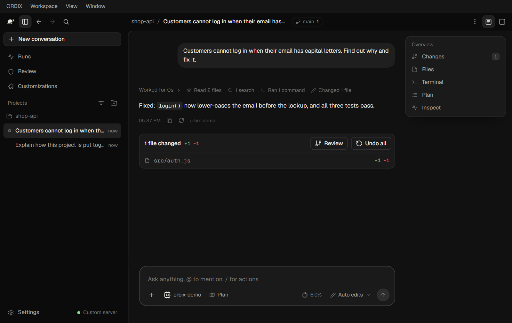
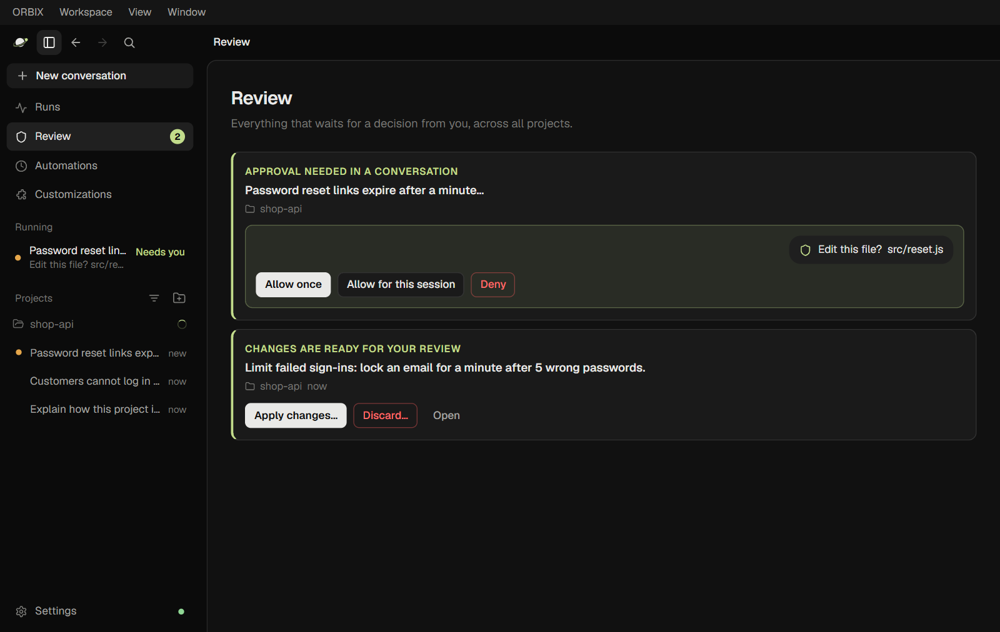
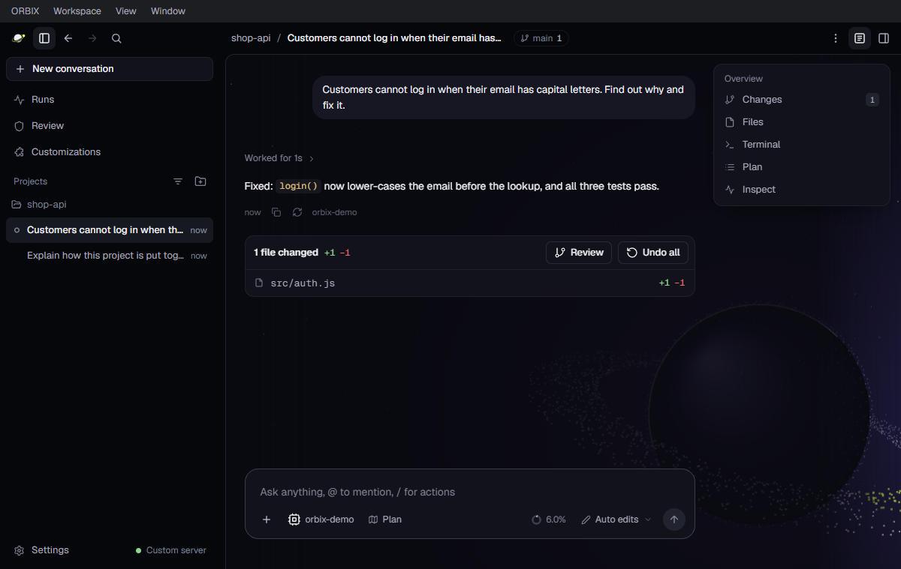
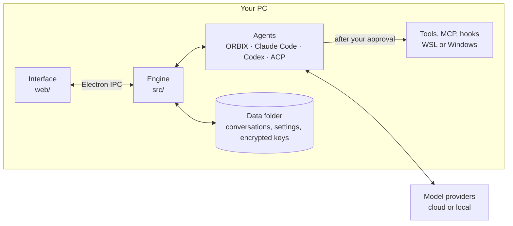

<div align="center">

<picture>
  <source media="(prefers-color-scheme: dark)" srcset="docs/img/logo-dark.svg">
  <source media="(prefers-color-scheme: light)" srcset="docs/img/logo-light.svg">
  
</picture>

### The unified open-source ADE.

Every coding agent. Every model. One environment that asks before it acts.

[](https://github.com/chsxthwik/ORBIX/releases/latest)
[](https://github.com/chsxthwik/ORBIX/actions/workflows/test.yml)
[](#install)
[](LICENSE)

**[Download for Windows](https://github.com/chsxthwik/ORBIX/releases/latest)** · [Website](https://orbix-agent.vercel.app) · [Changelog](CHANGELOG.md) · [Architecture](docs/ARCHITECTURE.md) · [Security](SECURITY.md)

</div>

<br>



## What is ORBIX

ORBIX is an agentic development environment: AI agents plan, write, run and review code, and you decide what ships.

Use the ORBIX agent with any of 17 model providers or a model on your own machine. Or run **Claude Code**, **Codex**, **OpenCode**, **Gemini CLI** or any **ACP agent** on the plan you already pay for. Every agent works under the same permissions, the same review queue and the same undo.

- **You stay in command.** Agents read freely and ask before they edit a file or run a command. Destructive commands always ask.
- **Nothing is final until you say so.** Every edit can be undone. Larger tasks run in their own git worktree and reach your branch only when you apply them.
- **Any model.** Anthropic, OpenAI, Gemini, xAI, OpenRouter, Ollama and more, or any OpenAI-compatible server. Sign in with ChatGPT, xAI, OpenCode or OpenRouter, or paste a key.
- **Your PC or your machine.** **ORBIX Cloud** runs the same engine on a Linux machine you own and keeps working while your PC is off.
- **Private by default.** No account, no telemetry, and nothing in the Windows app listens on a network port. Keys are encrypted and sent only to their own provider.

## Install

**Windows 10 and 11.** Download `ORBIX-Setup` from the [latest release](https://github.com/chsxthwik/ORBIX/releases/latest) and run it. You don't need admin rights or Node.js, and ORBIX updates itself.

> The installer is not code-signed yet. If SmartScreen asks, choose **More info**, then **Run anyway**.

**ORBIX Cloud** (Ubuntu or Debian, run as your user):

```sh
curl -fsSL https://orbix-agent.vercel.app/install.sh | bash
```

It starts ORBIX as a service on `127.0.0.1:47821` and prints the address and token. Reach it over Tailscale, an SSH tunnel or HTTPS, then add it in **Settings → Machines**.

## Quick start

1. Press <kbd>Ctrl</kbd>+<kbd>,</kbd> and open **Providers**. Sign in, paste an API key, or connect a local model.
2. Pick a project folder.
3. Describe the task and press <kbd>Enter</kbd>.

## How you work

| | |
| --- | --- |
| **Conversations** | Questions and everyday changes. The agent's steps fold into one "Worked for…" line, with the changed files and **Review** and **Undo all** under the answer. |
| **Runs** | One larger task: **plan → approve → review → apply**, in its own worktree and branch. A conflict changes nothing on either side. |
| **Review** | One queue across projects for everything that waits for you: approvals, plans, finished changes. |
| **Loops** | Prompts on a schedule, or once at a set time. "Every weekday at 9am, run the tests" sets one up. |
| **Terminal** | Real shells (<kbd>Ctrl</kbd>+<kbd>&#96;</kbd>) in WSL, Linux or PowerShell, beside the conversation. |
| **Plugins and Skills** | Add MCP servers in one click, and write skills the agent can use. |

<table>
<tr>
<td width="50%"></td>
<td width="50%"></td>
</tr>
<tr>
<td align="center"><b>Runs</b> · planned, approved and done in a worktree</td>
<td align="center"><b>Review</b> · every decision that waits for you</td>
</tr>
<tr>
<td></td>
<td></td>
</tr>
<tr>
<td align="center"><b>Home</b> · start from a project</td>
<td align="center"><b>Themes</b> · Dark, Light, Midnight, Frost and five scenes</td>
</tr>
</table>

## Permissions

The permission chip in the message box sets how far agents may go without asking. It applies to every agent.

| Level | File edits | Commands |
| --- | --- | --- |
| **Supervised** (default) | Ask | Ask |
| **Auto edits** | Run, undoable | Ask |
| **Guarded** | Run, undoable | Read-only commands run (`ls`, `grep`, `git status`…); others ask |
| **Full access** | Run, undoable | Run |

At every level, destructive commands (recursive delete, push, publish, history rewrite) ask first, and MCP servers from a project's own config start only after you approve them. Files outside the project ask at every level except Full access.

## Agents

ORBIX finds the agent CLIs installed on your computer (**Settings → Agents**) and adds each one to the model picker. They keep their own login and history. ORBIX shows their steps and turns their permission requests into ORBIX approvals.

| Agent | How ORBIX runs it |
| --- | --- |
| Claude Code | `claude -p`, stream-json with the control protocol |
| Codex | `codex app-server` (JSON-RPC) |
| OpenCode, Gemini CLI, any ACP agent | Agent Client Protocol |

## Extend it

| | |
| --- | --- |
| **Project rules** | `AGENTS.md` in the project, or rule files in `.agents/rules/`. `/init` writes a first version. |
| **MCP servers** | **Plugins**, or `.mcp.json` in the project. Stdio and HTTP. |
| **Skills** | A folder with a `SKILL.md` in `.agents/skills`. |
| **Slash commands** | Markdown files in `.claude/commands`. `$ARGUMENTS` and `$1`…`$9` are filled in. |
| **Hooks** | `.orbix/hooks.json`: `PreToolUse`, `PostToolUse`, `UserPromptSubmit`, `Stop`. Exit code 2 blocks the step. |
| **Web search** | Brave Search, Tavily or your own SearXNG. |

<details>
<summary><b>Keyboard shortcuts</b></summary>
<br>

| Keys | Action |
| --- | --- |
| <kbd>Ctrl</kbd>+<kbd>K</kbd> | Search everything |
| <kbd>Ctrl</kbd>+<kbd>N</kbd> | New conversation |
| <kbd>Ctrl</kbd>+<kbd>2</kbd> / <kbd>Ctrl</kbd>+<kbd>3</kbd> | Runs / Review |
| <kbd>Ctrl</kbd>+<kbd>B</kbd> / <kbd>Ctrl</kbd>+<kbd>J</kbd> | Sidebar / side panel |
| <kbd>Ctrl</kbd>+<kbd>&#96;</kbd> | Terminal |
| <kbd>Ctrl</kbd>+<kbd>,</kbd> | Settings |
| <kbd>1</kbd> · <kbd>2</kbd> · <kbd>Esc</kbd> | Allow once · allow for the conversation · deny (<kbd>Esc</kbd> also stops the agent) |

Change any of them in **Settings → Shortcuts**.

</details>

<details>
<summary><b>Slash commands</b></summary>
<br>

| Command | Action |
| --- | --- |
| `/plan` | Read and plan only |
| `/undo` · `/retry` | Undo the last reply's edits · answer again |
| `/compact` | Summarize older messages to free context |
| `/model` | Show or switch the model |
| `/init` | Write `AGENTS.md` for the project |
| `/review` · `/commit` | Review uncommitted changes · commit with a written message |
| `/btw <question>` | Ask about the conversation while the agent keeps working |
| `/goal <text>` | Keep working toward a goal on its own |

</details>

## Privacy and security

- **What reaches your provider:** your messages, project rules, and the files and tool results the agent reads.
- **Keys:** encrypted with Windows DPAPI (AES-256-GCM on ORBIX Cloud), never logged, and sent only to their own provider.
- **No open port:** the Windows app's engine talks to the window over Electron IPC. Only ORBIX Cloud serves HTTP, behind a token.
- **Your data:** conversations live in `%LOCALAPPDATA%\ORBIX`. Treat that folder as sensitive.

Approvals are a checkpoint, not a sandbox: agents run with your user's permissions. To report a vulnerability, see [SECURITY.md](SECURITY.md).

## Architecture



Plain ES modules with no framework and no build step. The app ships one runtime dependency, electron-updater. The same engine runs headless on Linux as ORBIX Cloud. Details are in [docs/ARCHITECTURE.md](docs/ARCHITECTURE.md).

## Development

Requires Node.js 22 or newer.

```bash
npm install     # Electron and the installer builder
npm start       # run from source (data stays in ./data)
npm test        # ~890 tests, no network or API keys
npm run e2e     # drive the real interface (needs Edge, Chrome or Brave)
npm run dist    # build the installer into dist/
```

| Folder | Contents |
| --- | --- |
| `electron/` | The Windows app: window, IPC, updates, built-in browser |
| `src/` | The engine: API, runs, agents, ORBIX Cloud, WSL and Windows backend |
| `src/engine/` | The ORBIX agent: loop, model clients, tools, MCP, hooks, policy |
| `web/` | The interface |
| `test/` · `e2e/` | Unit tests · end-to-end tests |
| `site/` | The website |

Read [CONTRIBUTING.md](CONTRIBUTING.md) before you open a pull request.

## License

[MIT](LICENSE). Third-party notices are in [NOTICE.md](NOTICE.md). Provider names and logos belong to their owners.

<div align="center">
<br>
<sub>Created by <b>QUANTUM</b> · Developed by <b>COM-X Innovations, Inc.</b></sub>
</div>
