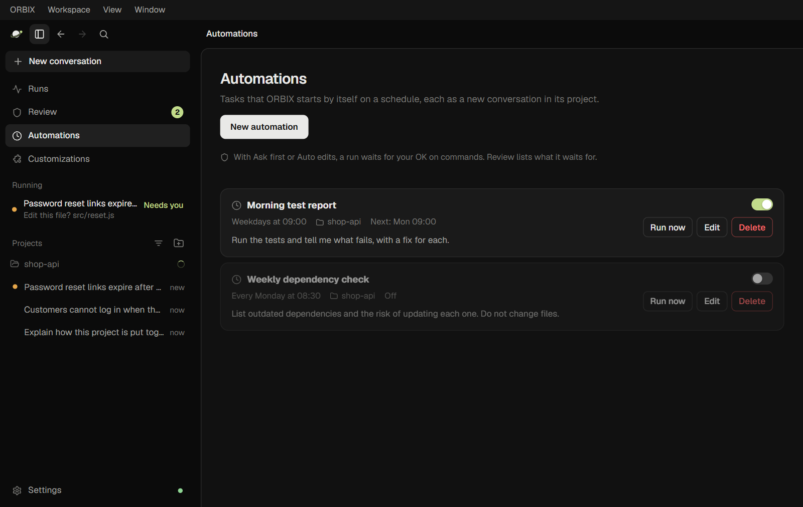
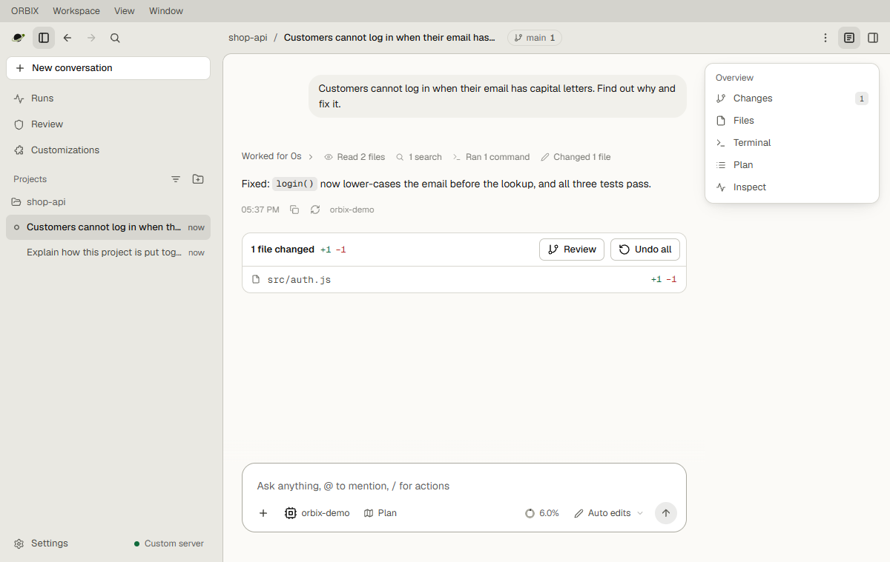
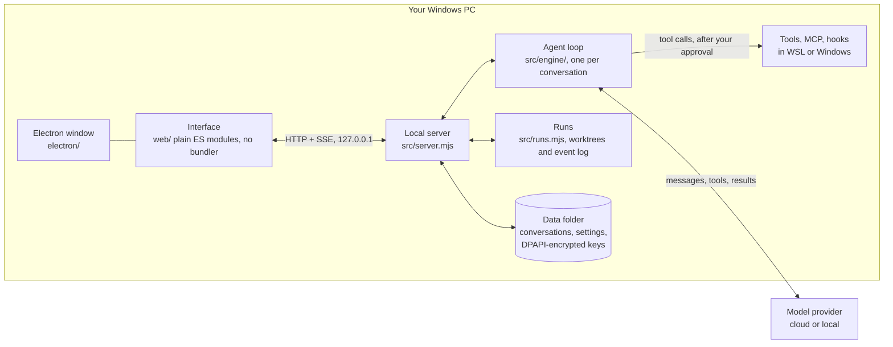

<div align="center">

<picture>
  <source media="(prefers-color-scheme: dark)" srcset="docs/img/logo-dark.svg">
  <source media="(prefers-color-scheme: light)" srcset="docs/img/logo-light.svg">
  
</picture>

### The coding agent for Windows that asks first.

Plan, approve, review and apply, with any model you choose.<br>
Every edit waits for your OK and can be undone. Everything runs on your PC.

[](https://github.com/chsxthwik/ORBIX/releases/latest)
[](https://github.com/chsxthwik/ORBIX/actions/workflows/test.yml)
[](#install)
[](LICENSE)

**[Download for Windows](https://github.com/chsxthwik/ORBIX/releases/latest)** · [Website](https://orbix-agent.vercel.app) · [Changelog](CHANGELOG.md) · [Architecture](docs/ARCHITECTURE.md) · [Security](SECURITY.md)

</div>

<br>


<sub>Screenshots come from the real app on a sample project with a scripted local model; the tools in them really ran.</sub>

## Why ORBIX

- **You stay in control.** Reading is free; edits and commands follow the permission chip in the message box: **Ask first**, **Auto edits** or **Turbo**. Destructive commands (recursive delete, push, publish, history rewrite) ask every time, in every mode.
- **Nothing is final until you say so.** Every file edit can be undone, one at a time or a whole reply at once. Runs work in their own git worktree and only reach your branch when you apply them.
- **Any model.** 17 providers and any OpenAI-compatible server, including your ChatGPT plan without an API key, or a model on your own PC.
- **Built for Windows.** Commands run in WSL or in native Windows (`cmd.exe` or PowerShell), with paths translated between the two. A real installer, no admin rights, automatic updates.

## Install

Download `ORBIX-Setup` from the [latest release](https://github.com/chsxthwik/ORBIX/releases/latest) and run it. It installs for your Windows account, adds Start menu and desktop shortcuts, and needs no administrator rights and no Node.js. The installer is not code-signed yet, so SmartScreen asks the first time: choose **More info**, then **Run anyway**.

1. Press <kbd>Ctrl</kbd>+<kbd>,</kbd> and open **Providers**. Sign in (ChatGPT, xAI, OpenCode, OpenRouter), paste an API key and press **Check & save**, or connect a local model.
2. Choose a project folder, describe a task and press <kbd>Enter</kbd>.

ORBIX updates itself from GitHub releases: it downloads in the background and installs when you close it, or at once with **Restart** in the sidebar (Settings → Application → Updates turns this off). Settings and conversations live in `%LOCALAPPDATA%\ORBIX` and stay through every update. There is no account and no subscription; you pay your provider directly, or nothing with a local model.

## How you work in it

**Conversations** are for questions and everyday changes. The agent reads freely and asks before edits and commands (<kbd>1</kbd> allow once, <kbd>2</kbd> for the conversation, <kbd>Esc</kbd> deny). When a reply ends, its steps fold into one line ("Worked for 14s · Read 2 files · Ran 1 command") above the answer, with a card of the changed files and **Review** and **Undo all**.

**Runs** (<kbd>Ctrl</kbd>+<kbd>2</kbd>) take one larger task from description to reviewed changes:

1. **Plan.** The agent reads the code and writes an implementation plan, changing nothing. Comment on any passage and it writes a new revision.
2. **Approve a scope.** You allow file edits, or edits and commands, inside the run's own worktree and branch.
3. **Review.** Every step in the timeline opens what it produced: the diff, the test log, the walkthrough.
4. **Apply or discard.** Apply merges into the branch the run started from and keeps your own uncommitted work; a conflict changes nothing on either side.

**Review** (<kbd>Ctrl</kbd>+<kbd>3</kbd>) is one queue across projects for everything that waits for you: approvals, plans, finished changes, interrupted runs. If ORBIX closes mid-run, the run says what was in flight and continues only when you say so.

<table>
<tr>
<td width="50%"></td>
<td width="50%"></td>
</tr>
<tr>
<td><b>Runs.</b> Planned, approved and done in their own worktree.</td>
<td><b>Review.</b> Every decision that waits for you, buttons in place.</td>
</tr>
<tr>
<td></td>
<td></td>
</tr>
<tr>
<td><b>Changes.</b> What a run changed, file by file.</td>
<td><b>Home.</b> Pick a project and model, then describe the task.</td>
</tr>
<tr>
<td></td>
<td></td>
</tr>
<tr>
<td><b>Automations.</b> Prompts that run on a schedule, each as a new conversation.</td>
<td><b>Customizations.</b> MCP servers in one click, and what is installed.</td>
</tr>
<tr>
<td></td>
<td></td>
</tr>
<tr>
<td><b>Settings.</b> One card: General, Appearance, Shortcuts, Providers and more.</td>
<td></td>
</tr>
</table>

## The window

| Part | What it does |
| --- | --- |
| **Menu row and toolbar** | ORBIX, Workspace, View and Window menus. Back and forward (<kbd>Alt</kbd>+<kbd>←</kbd>/<kbd>→</kbd>) across conversations, Runs and Review; search everything (<kbd>Ctrl</kbd>+<kbd>K</kbd>); where you are, with the conversation's state, running time and branch. |
| **Sidebar** | New conversation, Runs, Review, Automations and Customizations; what is running; pinned conversations; your projects. A conversation shows a state only when it has one (working, needs you, unread). Rest the pointer on one for a preview card; pin or archive it from its row (<kbd>P</kbd>, <kbd>A</kbd>). The filter menu filters, sorts projects by activity or name, and shows archived conversations. |
| **Overview card** | Beside the conversation (<kbd>Ctrl</kbd>+<kbd>Alt</kbd>+<kbd>O</kbd>): Changes, Files, Terminal, Plan and the run inspector, plus helper agents and background runs when there are any. |
| **Side panel** | Opens on a first page (<kbd>Ctrl</kbd>+<kbd>J</kbd>): find a file, then Changes, Files, Terminal, Browser, Side question, Plan and Inspect, with the conversation's helper agents and the runs working now. Changes can stage, unstage, discard and commit; a conversation on its own branch also gets Review. **Browser** starts on the web apps running on this computer; in the Windows app it is a real browser with its own session (any site, back and forward, downloads), in a web browser it shows only this computer's pages. **Side question** answers a quick question about the conversation while the agent keeps working. |
| **Automations** | Prompts ORBIX starts by itself every hour, every day, on weekdays or every week, each as a new conversation in its project. **Create with Prompt** turns one sentence ("every weekday at 9am, run the tests") into the schedule and the task. Run now, turn on or off, edit. In Ask first a run waits for your OK in Review. |
| **Customizations** | Marketplace and Installed, with one search box. The marketplace adds well-known MCP servers in one click (Playwright, Chrome DevTools, Context7, GitHub, Supabase, Figma, Notion, Stripe and more); Installed lists your MCP servers, skills and the project's rules. |
| **Home** | The ORBIX mark and a greeting; suggestions and the message box at the bottom, with the project and the project-folder or separate-branch choice on a strip on top of the box. |
| **Settings** | A card over the workspace (<kbd>Ctrl</kbd>+<kbd>,</kbd>; <kbd>Esc</kbd> closes; <kbd>Ctrl</kbd>+<kbd>K</kbd> finds any setting). **General**: permission preset, tool permissions, network access rules, Steer or Queue while the agent works, the send key. **Application**: prevent sleep while agents work, keep running in the tray, Windows notification settings, WSL, updates, data folder, help. **Appearance** (steps Default or Verbose, theme, contrast, font, font size, your own colours, conversation width, screen reader mode), **Shortcuts** (change any key), **Notifications** (with volume), **Providers**, **Models**, **Browser** (where links open, downloads, history, site data). Customizations: Instructions, Checks, Tools & MCP. A page per project (folder, recent conversations, its instruction and rule files, its check command), Conversations (archived and recently deleted), Worktrees, and **Give feedback**. |
| **Message box** | <kbd>+</kbd> adds files, a mention (<kbd>@</kbd>) or a command (<kbd>/</kbd>); the model and its thinking level; the permission chip; the context meter. |
| **Conversation** | A centred column; the steps of a turn fold into one "Worked for…" line above the answer. Readable Markdown with code blocks and tables; under each reply copy, 👍, 👎 (answer again, another model, or report it) and retry. A navigator of dots on the left edge (one per message of yours), find (<kbd>Ctrl</kbd>+<kbd>F</kbd>), focus mode (<kbd>Ctrl</kbd>+<kbd>Shift</kbd>+<kbd>F</kbd>). The side panel stays closed until you open it. |

## Models

<picture>
  <source media="(prefers-color-scheme: dark)" srcset="docs/img/providers-dark.png">
  <source media="(prefers-color-scheme: light)" srcset="docs/img/providers-light.png">
  
</picture>

**ChatGPT** uses the models on your ChatGPT Plus or Pro plan: sign in, no API key. It goes through the same sign-in and endpoint as the OpenAI Codex CLI, which is unofficial and can change. **xAI**, **OpenCode** and **OpenRouter** also offer a sign-in; sign-ins renew themselves.

Model lists come live from each provider and offer chat models only. Context sizes, prices and thinking support come from the [models.dev](https://models.dev) catalog (refreshed at most once a day) unless the provider reports them itself, and each model offers only the thinking levels its API accepts. Separate fast and plan models can be set in Settings → Models. The custom server works with vLLM, llama.cpp, a company gateway or anything that speaks the OpenAI chat API.

## Security and privacy

Approvals are a checkpoint, not a sandbox: the agent runs with your Windows user's permissions, so read what you approve.

| Action | Ask first (default) | Auto edits | Turbo |
| --- | --- | --- | --- |
| Reading and searching | Runs | Runs | Runs |
| `write`, `edit` | Asks | Runs (undoable) | Runs (undoable) |
| `bash` | Asks, unless the command is trusted | Asks, unless trusted | Runs |
| Destructive commands (recursive delete, push, publish, history rewrite, system changes) | Asks | Asks | **Asks** |
| Files outside the project folder | Asks | Asks | Runs |
| MCP tools | Ask, unless the server marks them read-only | Ask, unless read-only | Run |
| `web_fetch` | Runs; denied sites never, and with an allowed list other sites ask | Same | Same |
| Project MCP servers and hooks | Do not start until you approve them | Same | Same |

- **Local server:** listens only on `127.0.0.1`, behind a per-launch token in an `HttpOnly`, `SameSite=Strict` cookie; checks `Host` and `Origin`; serves the interface with a strict Content Security Policy.
- **API keys:** encrypted for your Windows account with DPAPI, sent only to their own provider, never written to the log.
- **What reaches your provider:** your messages, tool definitions, project rules and tool results, including the contents of files the agent reads.
- **Other network use:** the models.dev catalog, update checks on GitHub (unless turned off), the sign-ins you use, and `web_fetch` / `web_search` when the agent calls them. **No telemetry.**
- **On disk:** conversations are plain text in `%LOCALAPPDATA%\ORBIX` (or `data/` in a clone) and can contain anything that appeared in a chat; treat that folder as sensitive. A deleted conversation stays in its `trash` folder for 30 days (Settings → Projects → Recently deleted), then it is removed for good.

To report a vulnerability, see [SECURITY.md](SECURITY.md).

## Extending ORBIX

| Feature | Where it lives |
| --- | --- |
| **Project rules** | `AGENTS.md`, `CLAUDE.md` or `.omp/AGENTS.md` in the project. `/init` writes a first version. |
| **Rule files** | `.agents/rules/*.md` in the project. Front matter `trigger:` `always_on` (default, in every prompt), `model_decision` (with a `description`: the agent reads it when it applies), `glob` (with `globs`: for matching files) or `manual` (only when you @mention it). |
| **Your instructions** | Settings → Instructions: followed in every project. |
| **MCP servers** | Customizations (Settings → Tools & MCP), or `.mcp.json` in the project. Stdio and HTTP. |
| **Skills** | A folder with a `SKILL.md` in `.agents/skills`, `.claude/skills` or `.omp/skills`. |
| **Slash commands** | Markdown files in `.omp/commands` or `.claude/commands`. `$ARGUMENTS` and `$1` to `$9` are filled in. |
| **Hooks** | `hooks.json` in the data folder, or `.orbix/hooks.json` in a project. Events: `PreToolUse`, `PostToolUse`, `UserPromptSubmit`, `Stop`. Exit code 2 blocks the step and tells the model why. |
| **Web search** | Settings → Tools & MCP: Brave Search, Tavily or your own SearXNG. |
| **Network access rules** | Settings → General: sites `web_fetch` may read without asking, and sites it may never read (also after a redirect). With an allowed list, every other site asks first. |

<details>
<summary><b>Keyboard shortcuts</b></summary>
<br>

The defaults. Settings → Shortcuts changes any of them: <kbd>+</kbd> records new keys, the bin removes them.

| Keys | Action |
| --- | --- |
| <kbd>Ctrl</kbd>+<kbd>K</kbd> / <kbd>Ctrl</kbd>+<kbd>P</kbd> | Search everything (settings too) / find a file |
| <kbd>Ctrl</kbd>+<kbd>N</kbd> | New conversation |
| <kbd>Ctrl</kbd>+<kbd>2</kbd> / <kbd>Ctrl</kbd>+<kbd>3</kbd> / <kbd>Ctrl</kbd>+<kbd>U</kbd> | Runs / Review / Automations |
| <kbd>Alt</kbd>+<kbd>←</kbd> / <kbd>Alt</kbd>+<kbd>→</kbd> (or <kbd>Ctrl</kbd>+<kbd>[</kbd> / <kbd>Ctrl</kbd>+<kbd>]</kbd>) | Back / forward |
| <kbd>Ctrl</kbd>+<kbd>B</kbd> / <kbd>Ctrl</kbd>+<kbd>J</kbd> / <kbd>Ctrl</kbd>+<kbd>Alt</kbd>+<kbd>O</kbd> | Sidebar / side panel / Overview card |
| <kbd>Ctrl</kbd>+<kbd>,</kbd> / <kbd>Ctrl</kbd>+<kbd>/</kbd> | Settings / keyboard shortcuts |
| <kbd>Ctrl</kbd>+<kbd>Shift</kbd>+<kbd>.</kbd> / <kbd>Ctrl</kbd>+<kbd>Shift</kbd>+<kbd>,</kbd> | Next / previous side panel tab |
| <kbd>Ctrl</kbd>+<kbd>L</kbd> | Focus the message box |
| <kbd>Ctrl</kbd>+<kbd>F</kbd> / <kbd>Ctrl</kbd>+<kbd>Shift</kbd>+<kbd>O</kbd> | Find in the conversation / jump to one of your messages |
| <kbd>Alt</kbd>+<kbd>1</kbd> to <kbd>9</kbd>, <kbd>Ctrl</kbd>+<kbd>Tab</kbd> | Switch between open conversations |
| <kbd>Alt</kbd>+<kbd>↑</kbd> / <kbd>Alt</kbd>+<kbd>↓</kbd> | Previous / next message of yours |
| <kbd>Enter</kbd> / <kbd>Alt</kbd>+<kbd>Enter</kbd> | While the agent works: steer / queue (Settings → General can swap them) |
| <kbd>1</kbd> <kbd>2</kbd> <kbd>Esc</kbd> | Allow once / allow for the conversation / deny; <kbd>Esc</kbd> also stops the agent |

</details>

<details>
<summary><b>Slash commands</b></summary>
<br>

| Command | Action |
| --- | --- |
| `/plan` | Toggle plan mode: the agent only reads and plans |
| `/undo` | Undo the file changes from the last reply |
| `/retry` | Answer the last message again |
| `/compact [focus]` | Summarize older messages to free up context |
| `/model [fast\|plan] [provider/model]` | Show or switch a model |
| `/cost` | Tokens and cost of this conversation |
| `/init [focus]` | Write an `AGENTS.md` with the project's rules |
| `/review [focus]` | Review uncommitted changes for bugs and risks |
| `/commit [notes]` | Write a message for the staged changes and commit |
| `/branch` | Continue in a new conversation from here; files are not reverted |
| `/btw <question>` | Ask about the conversation in the side panel while the agent keeps working; nothing is added to it |
| `/goal <text>` | Keep working on a goal by itself, for up to 6 rounds |
| `/memory`, `/hooks`, `/mcp`, `/skills`, `/help` | The project memory file, hooks, MCP servers, skills and help |

</details>

## Themes

Settings → Appearance: System, Dark, Light, Midnight and Frost, plus five scene themes with a moving picture behind the conversation (ORBIX, Synthwave, Koi pond, Aurora, Halftone dusk). Scenes speed up while the agent works and send up fireworks when a task finishes; **Animate scenes** or the Windows reduce-motion setting keeps everything still.

<table>
<tr>
<td width="50%"></td>
<td width="50%"></td>
</tr>
<tr>
<td><b>Light</b></td>
<td><b>ORBIX</b> scene</td>
</tr>
</table>

## Architecture



ORBIX is a local Node.js server and an interface in plain ES modules, shown in an Electron window. There is no framework and no build step; the only npm package the app ships is electron-updater. [docs/ARCHITECTURE.md](docs/ARCHITECTURE.md) covers start-up, the API, the agent loop, tools, runs and storage, and [docs/parity.md](docs/parity.md) tracks the feature matrix.

## Development

Node.js 22 or newer.

```bash
npm install        # Electron and the installer builder
npm start          # run the app from source (data stays in ./data)
npm test           # about 820 tests: no network, no API keys
npm run e2e        # a run and a conversation driven through the real interface (needs Edge, Chrome or Brave)
npm run dist       # build the installer into dist/
```

```text
electron/   the Windows app: window, title bar, updates
src/        the local server: HTTP API, event stream, runs, WSL and Windows backend
src/engine/ the agent: loop, model clients, tools, MCP, hooks, policy, conversations
web/        the interface: plain ES modules and CSS
test/       regression tests on Node's built-in runner
e2e/        end-to-end tests in headless Chromium against a scripted model
tools/      shots.mjs: the README and website screenshots, taken from a real ORBIX
site/       the website
```

Read [CONTRIBUTING.md](CONTRIBUTING.md) before opening a pull request.

## License

[FSL-1.1-MIT](LICENSE): free to use, read, modify and distribute for any purpose except a competing product; each release becomes MIT two years after its date. Third-party notices are in [NOTICE.md](NOTICE.md). Provider logos are trademarks of their owners and only identify each provider.

<div align="center"><sub>Developed by COM-X Corporation.</sub></div>
