<div align="center">

<picture>
  <source media="(prefers-color-scheme: dark)" srcset="docs/img/banner.svg">
  <source media="(prefers-color-scheme: light)" srcset="docs/img/banner-light.svg">
  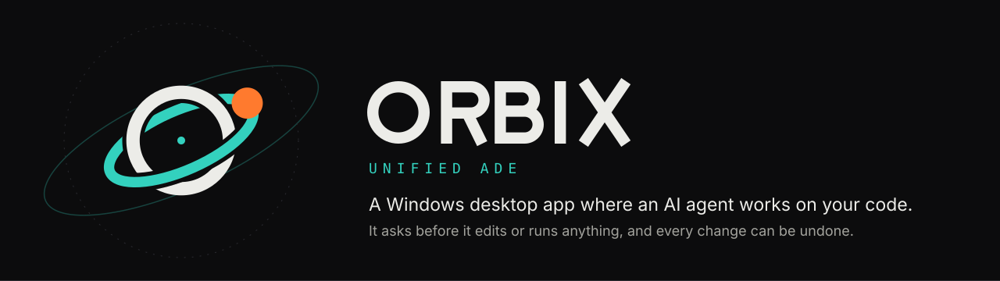
</picture>

[](LICENSE)
[](#requirements)
[](CHANGELOG.md)
[](#providers)
[](#build-from-source)

[Quick start](#quick-start) | [Demo](#30-second-demo) | [Features](#features) | [How it works](#how-it-works) | [Providers](#providers) | [Safety](#safety) | [FAQ](#faq) | [Build](#build-from-source) | [Website](https://orbix-agent.vercel.app)

</div>

ORBIX is a native Windows app where an AI agent works on your code. It reads your files, edits them and runs commands. You see every step, approve every change and can undo any of it. You bring your own API key or a local model. The release zip carries its own Node.js, so there is nothing to install.

## 30-second demo

<p align="center">
  
  <br><sub>Illustrated storyboard of one task. Real screenshots are in the <a href="#screenshots">gallery</a>.</sub>
</p>

## Quick start

1. **Unzip** the release anywhere. For daily use run `tools\install.ps1` once — it installs ORBIX to `%LOCALAPPDATA%\Programs\ORBIX` and adds Desktop and Start-menu shortcuts. Or just double-click `bin\ORBIX.exe` (or `ORBIX.vbs`) to run it portably.
2. Press <kbd>Ctrl</kbd>+<kbd>,</kbd>, open **AI providers**, paste an API key and press **Check & save**. You can also sign in with OpenRouter or connect a local model.
3. **Pick a project folder** on the home screen, describe a task and press <kbd>Enter</kbd>.

When the agent wants to edit a file or run a command it asks: **Allow once**, **Allow for this session** or **Deny**. If something looks wrong, press <kbd>Ctrl</kbd>+<kbd>K</kbd> and choose **Diagnostics**.

### Requirements

Windows 10 or 11 (x64) with the WebView2 Runtime (included in Windows 11 and recent Windows 10), and an API key or a local model server.

## Features

<table>
<tr>
<td width="33%" valign="top"><br><b>Its own agent</b><br>Built in. Tools: read, write, edit, bash (PowerShell on Windows), glob, grep, web fetch, task list, and helper agents that research in parallel.</td>
<td width="33%" valign="top"><br><b>Approvals inline</b><br>The question shows the exact file or command above the message box. <kbd>1</kbd> allow once, <kbd>2</kbd> allow for the session, <kbd>Esc</kbd> deny.</td>
<td width="33%" valign="top"><br><b>Undo</b><br>Per-edit <b>Undo this change</b>, <b>Undo all</b> for a reply, and <code>/undo</code>. A summary card lists changed files with +/- counts.</td>
</tr>
<tr>
<td width="33%" valign="top"><br><b>17 providers</b><br>Anthropic, OpenAI, Gemini and more, plus local Ollama and LM Studio. Model lists, prices and context sizes come from the provider.</td>
<td width="33%" valign="top"><br><b>Thinking and cost</b><br>Thinking levels where the model has them. Tokens, context and cost in the status bar. Automatic retry when a provider is busy.</td>
<td width="33%" valign="top"><br><b>Project aware</b><br>Follows <code>AGENTS.md</code> and <code>CLAUDE.md</code>. Supports MCP servers, skills, custom slash commands and <code>@file</code> mentions.</td>
</tr>
<tr>
<td width="33%" valign="top"><br><b>Workspace</b><br>Tabs for sessions, file browser and viewer, git changes with diffs (stage, unstage, discard, commit), a console and a plan panel.</td>
<td width="33%" valign="top"><br><b>Windows or WSL</b><br>Run commands on Windows or inside WSL (Settings, Behavior). Projects can live on either side.</td>
<td width="33%" valign="top"><br><b>Command palette</b><br><kbd>Ctrl</kbd>+<kbd>K</kbd> for commands and saved chats. Light and dark themes. A notification when the agent finishes in the background.</td>
</tr>
</table>

## Screenshots

<p align="center">
  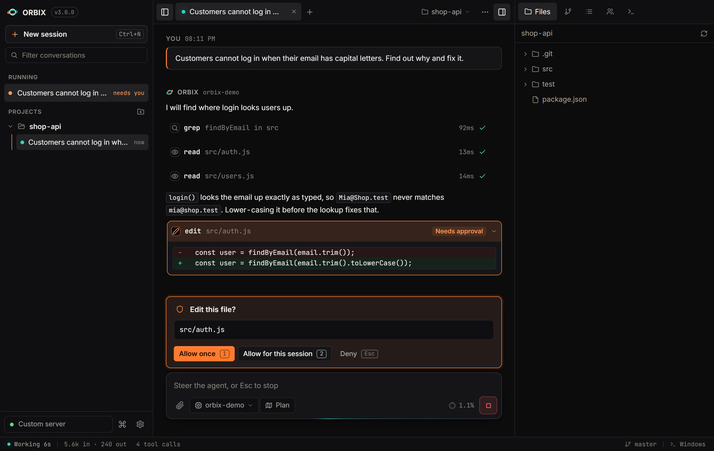
</p>

<details>
<summary><b>More screenshots</b></summary>
<br>
<table>
<tr>
<td width="50%">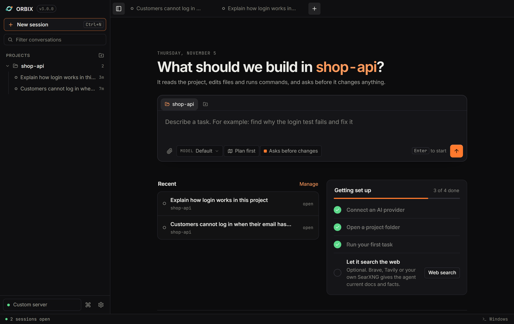<br><sub><b>Home.</b> Pick a project, describe a task, press Enter.</sub></td>
<td width="50%">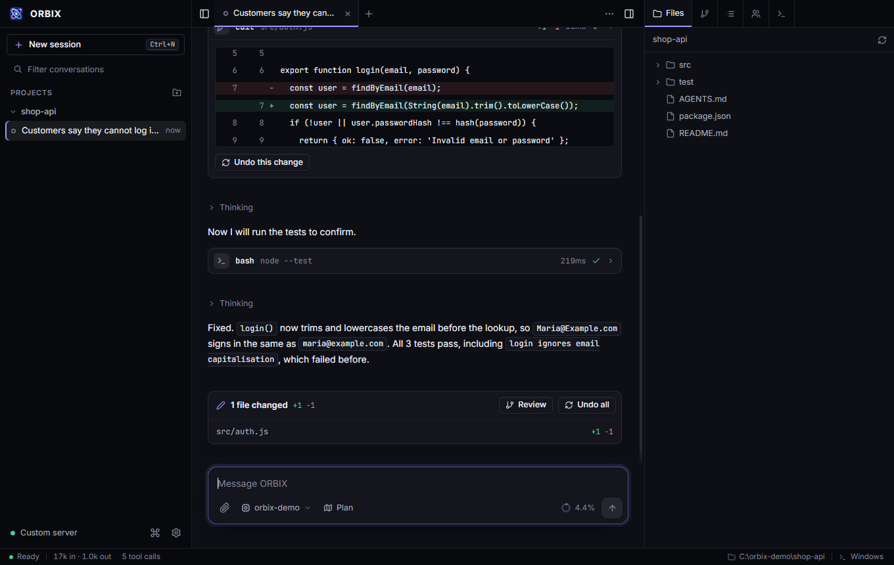<br><sub><b>Result.</b> Diff, Undo this change, and changed files.</sub></td>
</tr>
<tr>
<td>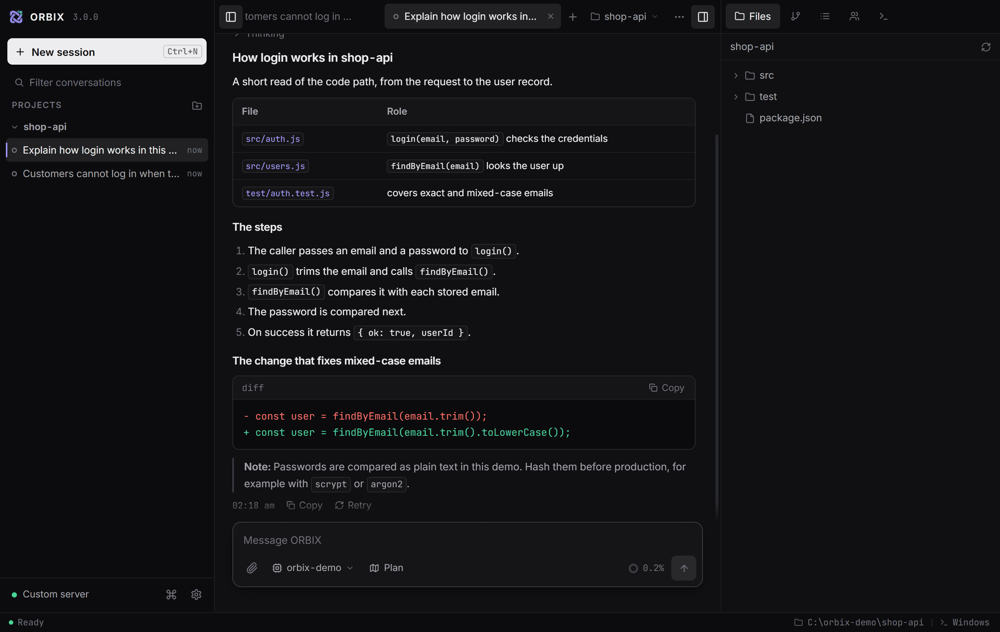<br><sub><b>Answers.</b> Markdown, tables, highlighted code and diffs.</sub></td>
<td>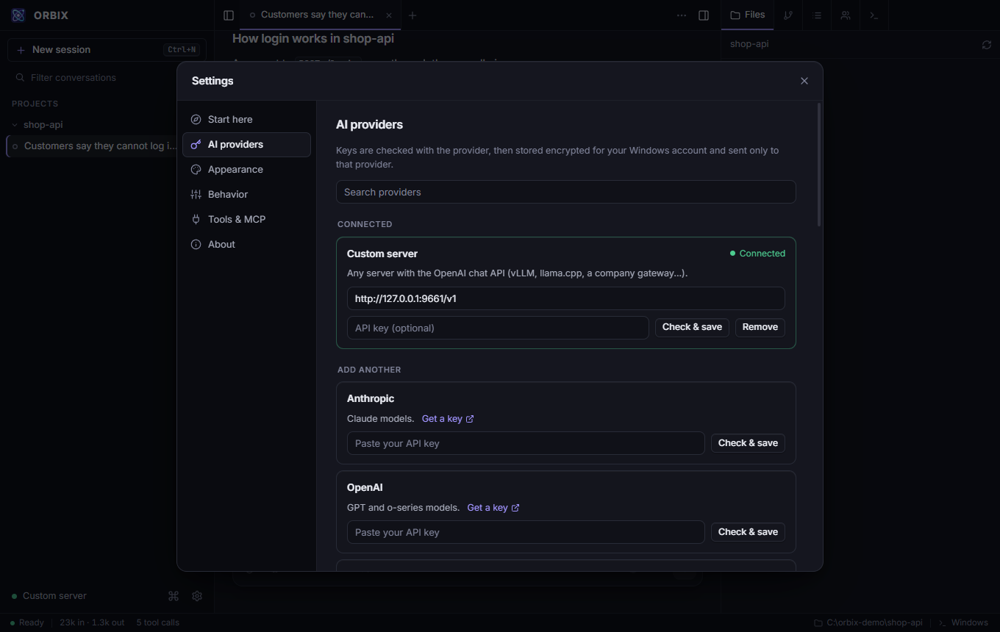<br><sub><b>Providers.</b> Paste a key, or connect a local model.</sub></td>
</tr>
<tr>
<td>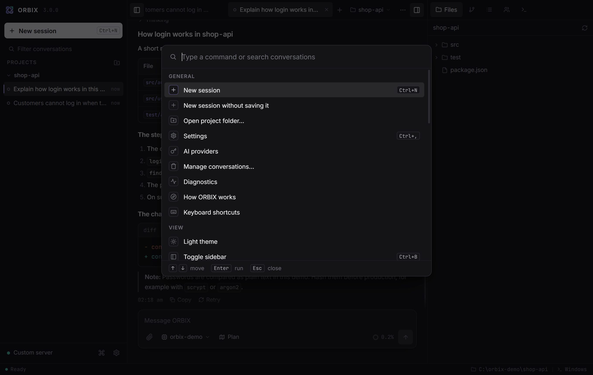<br><sub><b>Command palette</b> (Ctrl+K).</sub></td>
<td>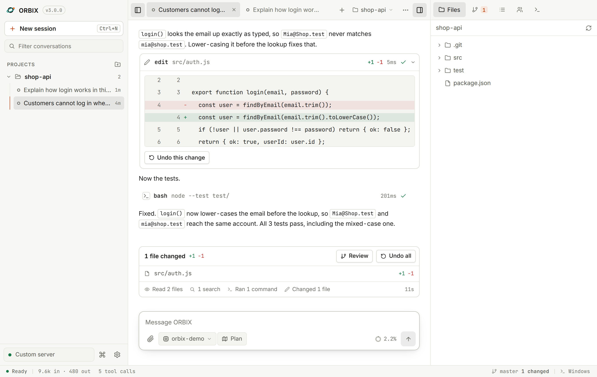<br><sub><b>Light theme.</b></sub></td>
</tr>
</table>
<sub>Screenshots use a demo project and a local demo model server, not a real account.</sub>
</details>

## How it works


The window (`bin\ORBIX.exe`) is a small native program that shows the interface (`web/`) in WebView2. It starts a local Node.js server (`src/`) that only this window can talk to. The server runs the agent, which calls the provider you chose and the tools on your PC. Conversations, settings and encrypted keys are saved in the `data` folder.

<details>
<summary><b>Architecture diagram</b></summary>
<br>
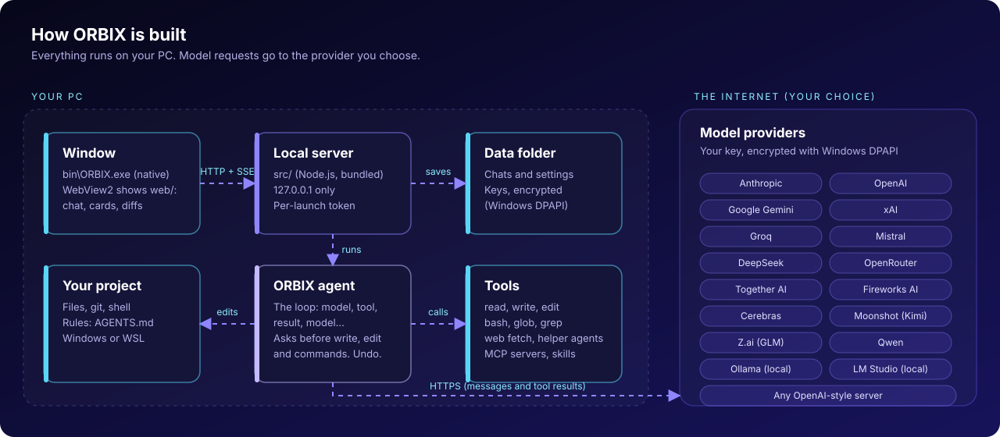
</details>

## Providers

Anthropic, OpenAI, Google Gemini, xAI, Groq, Mistral, DeepSeek, OpenRouter (key or sign-in), Together AI, Fireworks AI, Cerebras, Moonshot (Kimi), Z.ai (GLM), Qwen, plus local **Ollama** and **LM Studio**, and a **custom server** for any OpenAI-style API (vLLM, llama.cpp, a company gateway). Model lists come live from each provider, so they need the provider to be reachable.

## Safety

- Reading and searching never ask. Writing, editing and commands ask first. You can switch to "Allow everything" in Settings, Behavior.
- Every file change can be undone, per edit or for a whole reply.
- Keys are checked with the provider, then stored encrypted for your Windows account (DPAPI). They go only to the provider you chose.
- The server listens on `127.0.0.1` and needs a per-launch token. A strict Content-Security-Policy is served with the UI.
- Project MCP servers (`.mcp.json`) start only after you allow them, and the prompt shows the full command.
- Web fetch refuses local and private network addresses unless you approve.

The agent runs with your Windows user's permissions, so review what you approve. Details and how to report a vulnerability: [SECURITY.md](SECURITY.md).

## Keyboard shortcuts

| Keys | What it does |
| --- | --- |
| <kbd>Ctrl</kbd>+<kbd>K</kbd> | Command palette (commands and saved conversations) |
| <kbd>Ctrl</kbd>+<kbd>N</kbd> | New session |
| <kbd>Ctrl</kbd>+<kbd>,</kbd> | Settings |
| <kbd>Ctrl</kbd>+<kbd>B</kbd> / <kbd>Ctrl</kbd>+<kbd>J</kbd> | Show or hide the sidebar / side panel |
| <kbd>Ctrl</kbd>+<kbd>L</kbd> | Focus the message box |
| <kbd>Alt</kbd>+<kbd>1</kbd>...<kbd>9</kbd> | Switch to tab 1 to 9 |
| <kbd>Enter</kbd> / <kbd>Alt</kbd>+<kbd>Enter</kbd> | Send / queue a message while the agent works |
| <kbd>/</kbd> and <kbd>@</kbd> | Slash commands / mention a file |
| <kbd>1</kbd> <kbd>2</kbd> <kbd>Esc</kbd> | Approval: allow once / allow for session / deny (Esc also stops the agent) |

<details>
<summary><b>Slash commands, project rules, MCP, skills and hooks</b></summary>
<br>

**Slash commands**

| Command | What it does |
| --- | --- |
| `/plan` | Plan mode: the agent only reads and plans, it changes nothing |
| `/undo` | Undo the file changes from the last reply |
| `/retry` | Answer the last message again |
| `/compact [focus]` | Summarize older messages to free up context (also automatic near the limit) |
| `/model [provider/model]` | Show or switch the model |
| `/cost` | Tokens and cost of this session |
| `/init` | Write an `AGENTS.md` with the project's rules |
| `/review` | Review the uncommitted changes for bugs and risks |
| `/commit` | Write a message for the staged changes and commit (asks first) |
| `/branch` | Start a new session from the conversation up to a message of yours |
| `/goal <text>` | Keep working on a goal for up to 6 rounds. Esc or `/goal stop` ends it |
| `/memory`, `/hooks` | Show where `AGENTS.md` lives, and list the hooks that run |
| `/mcp`, `/skills`, `/help` | List MCP servers, skills, and what the agent can do |

**Project rules, MCP and skills**

| Feature | Where to put it |
| --- | --- |
| **Project rules** | `AGENTS.md` or `CLAUDE.md` at the project root (also `.omp/AGENTS.md`). The agent follows them in every session. `/init` writes a first version. |
| **MCP servers** | Settings, Tools & MCP, or a `.mcp.json` in the project. Project servers ask before they start. |
| **Skills** | A folder with a `SKILL.md` in `.agents/skills`, `.claude/skills` or `.omp/skills`. The agent reads one when it fits the task. |
| **Custom slash commands** | Markdown files in `.omp/commands` or `.claude/commands`. |
| **Hooks** | `hooks.json` in the app's data folder, or `.orbix/hooks.json` in a project (asks once). Events: `PreToolUse`, `PostToolUse`, `UserPromptSubmit`, `Stop`. Exit code 2 blocks the step and tells the model why. |
| **Model roles** | Settings, AI providers, Models: a fast model for titles, summaries and helper agents, and a plan model for `/plan`. |
| **Web search** | Settings, Tools & MCP: connect Brave Search, Tavily or your own SearXNG. The agent gets a `web_search` tool once one is set up. |
| **Branching** | Every message of yours has a Branch button that opens a new session from that point. |
</details>

## FAQ

<details>
<summary><b>Does ORBIX need an account or a subscription?</b></summary>
<br>
No ORBIX account. You bring your own API key (or a local model). You pay your provider directly, and the status bar shows tokens and cost when the model's price is known.
</details>

<details>
<summary><b>Where is my data?</b></summary>
<br>
In the <code>data</code> folder next to the app: conversations, settings and encrypted keys. Conversations can contain secrets that appeared in your chats, so treat that folder as sensitive. Your project files are only touched when you approve an edit.
</details>

<details>
<summary><b>What gets sent to the provider?</b></summary>
<br>
Your messages, the agent's tool definitions, your project rules, and the results of the tool steps (for example the text of a file the agent read). It goes only to the provider you selected.
</details>

<details>
<summary><b>Can I run it fully offline?</b></summary>
<br>
Yes, with a local model server such as Ollama or LM Studio. Model lists and web fetch need a network; a local server does not.
</details>

<details>
<summary><b>Do I need to install anything else, like Node.js?</b></summary>
<br>
No. The ORBIX agent is built in and the release zip bundles Node.js. Building from source needs Node.js 20 or newer.
</details>

## Build from source

```
npm run build      # bin\ORBIX.exe (uses the C# compiler built into Windows)
npm run package    # release\ORBIX-<version>-win-x64.zip
npm run doctor     # the Diagnostics checks, in the console
npm test           # regression tests (no network, no keys)
npm start          # run from source (Node.js 20 or newer)
```

No npm dependencies, no bundler, no framework. See [CONTRIBUTING.md](CONTRIBUTING.md) for the layout and ground rules, and [CHANGELOG.md](CHANGELOG.md) for what changed.

## License

[FSL-1.1-MIT](LICENSE): free to use, read, change and share for any purpose except selling a competing product. Each version becomes MIT two years after its release. Third-party notices are in [NOTICE.md](NOTICE.md).

<div align="center">
<br>
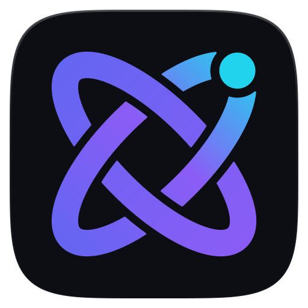
<br>
<sub><b>ORBIX - Unified ADE</b></sub>
</div>
