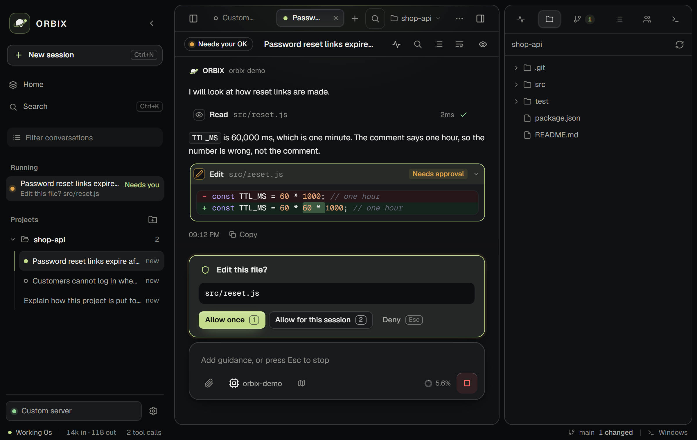
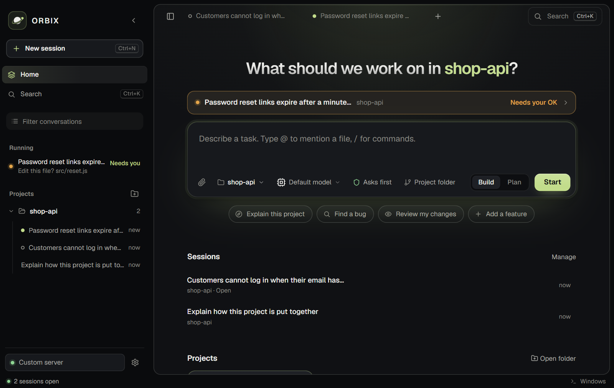
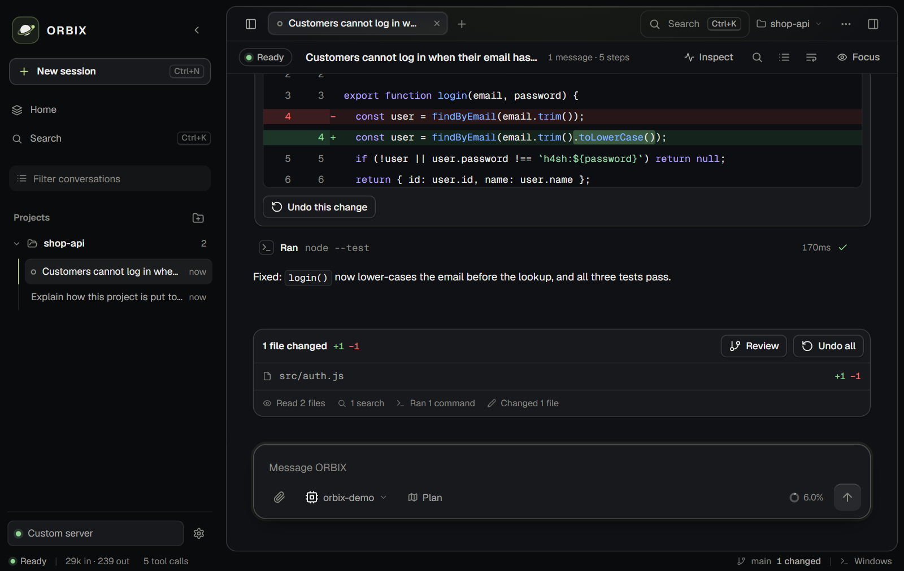
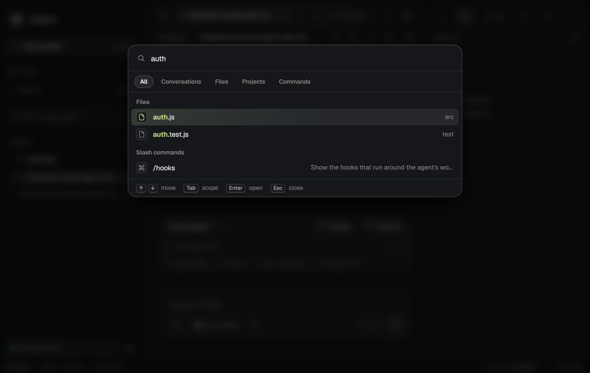
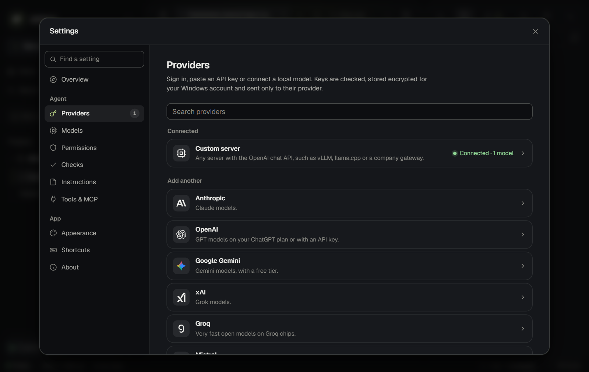
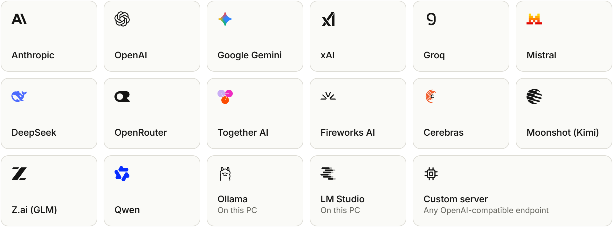
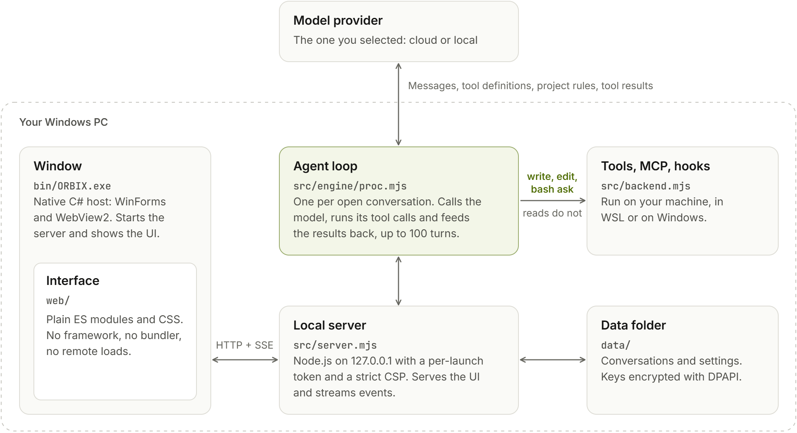
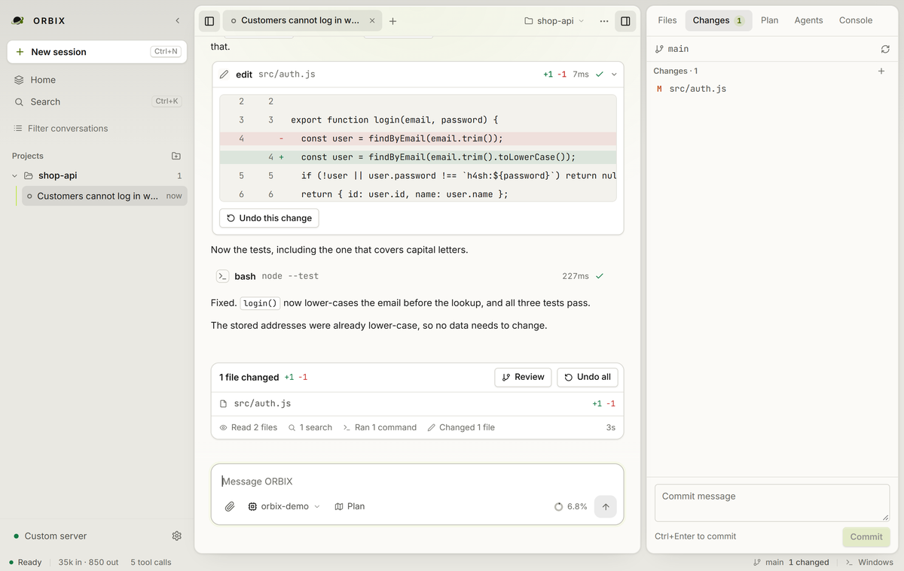
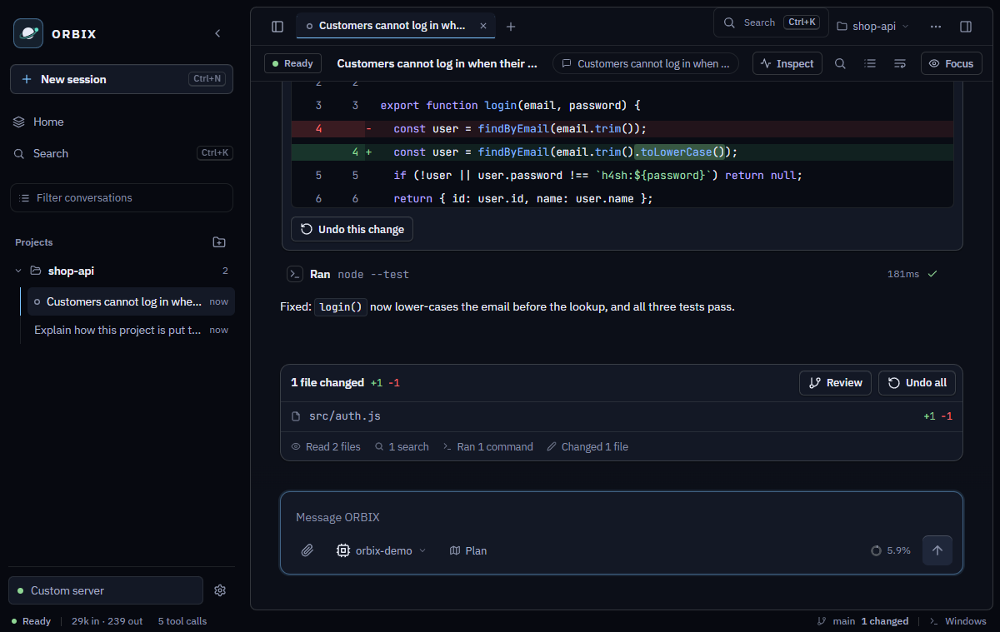
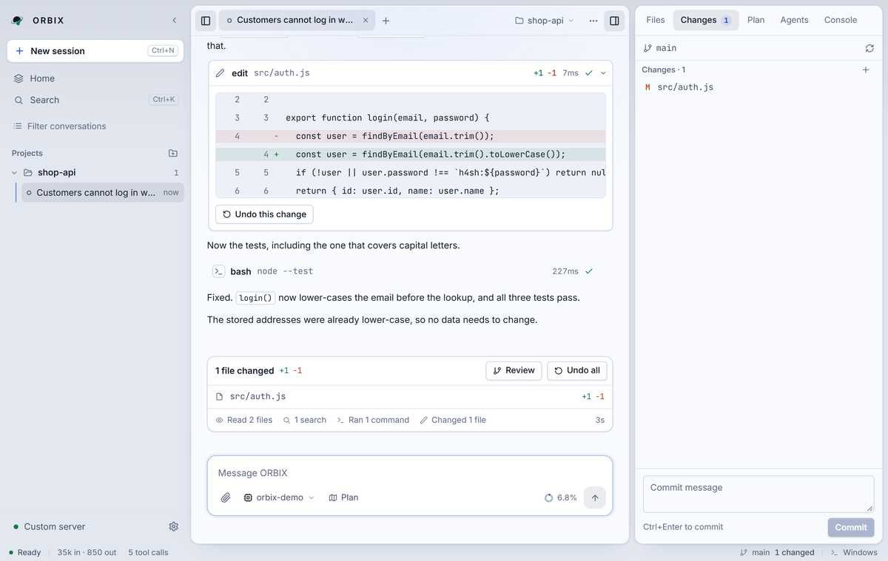

<div align="center">

<picture>
  <source media="(prefers-color-scheme: dark)" srcset="docs/img/logo-dark.svg">
  <source media="(prefers-color-scheme: light)" srcset="docs/img/logo-light.svg">
  
</picture>

**A local-first coding workspace that runs in your browser.**<br>
It asks before it edits a file or runs a command, and every file change can be undone.<br>
Bring your own API key or run a local model.

[](https://github.com/chsxthwik/ORBIX/releases/latest)
[](#install)
[](package.json)
[](LICENSE)

[Download](https://github.com/chsxthwik/ORBIX/releases/latest) · [Website](https://orbix-agent.vercel.app) · [Architecture](docs/ARCHITECTURE.md) · [Changelog](CHANGELOG.md) · [Security](SECURITY.md)

</div>

<br>



<sub>Screenshots use a sample project and a scripted local model; the tools in them really ran.</sub>

## Install

1. Install [Node.js 20 or newer](https://nodejs.org/).
2. Clone the repository, then start ORBIX:

   ```powershell
   git clone https://github.com/chsxthwik/ORBIX.git
   cd ORBIX
   npm start
   ```

3. ORBIX opens in your default browser. Press <kbd>Ctrl</kbd>+<kbd>,</kbd> and open **Providers**. Paste an API key and press **Check & save**, sign in with OpenRouter, or connect a local model.
4. Open a project folder in ORBIX, describe a task and press <kbd>Enter</kbd>.

ORBIX runs on Windows 10 and 11 with Node.js 20 or newer, using WSL or native Windows to run commands. The UI and agent server stay on your machine; there is no account or subscription. You pay your provider directly, or nothing with a local model.

## How a task runs

ORBIX reads and searches your project without interrupting you. When the agent wants to change a file or run a command, it stops and shows you exactly what it will do. You answer with <kbd>1</kbd> (allow once), <kbd>2</kbd> (allow for this session) or <kbd>Esc</kbd> (deny).

When the reply ends, a summary lists every changed file with line counts. Each edit has **Undo this change**, and **Undo all** reverts the whole reply.

<table>
<tr>
<td width="50%"></td>
<td width="50%"></td>
</tr>
<tr>
<td><b>Start.</b> Pick a project and a model, then describe the task.</td>
<td><b>Review.</b> The diff, the commands that ran and an undo for each change.</td>
</tr>
<tr>
<td></td>
<td></td>
</tr>
<tr>
<td><b>Find anything.</b> <kbd>Ctrl</kbd>+<kbd>K</kbd> searches conversations, files, projects and commands.</td>
<td><b>Connect a model.</b> Keys are checked with the provider before they are saved.</td>
</tr>
</table>

## What is included

| Area | Details |
| --- | --- |
| **Agent** | Tools for `read`, `write`, `edit`, `glob`, `grep`, `bash`, `todo`, `web_fetch` and `web_search`, plus `task`, which runs read-only helper agents side by side. Plan mode only reads. `/goal` keeps working for up to 6 rounds. Older messages are summarized when the context fills up. |
| **Models** | 17 providers, live model lists, thinking levels, and separate fast and plan models. Tokens and context show in the interface, and cost when the model's pricing is known. |
| **Workspace** | Session tabs, and a side panel with Files, Changes (stage, unstage, discard, commit), Plan, Agents and Console. Branch from any of your messages, attach images and files, mention files with `@`, export a conversation to HTML. |
| **Windows or WSL** | Commands, tools, MCP servers, git and hooks all run in one place: a WSL distribution, or Windows with `cmd.exe` or PowerShell. Paths are translated between the two. |
| **Project context** | Follows `AGENTS.md` or `CLAUDE.md`, and supports MCP, skills, custom slash commands and hooks. |

## Providers

<picture>
  <source media="(prefers-color-scheme: dark)" srcset="docs/img/providers-dark.png">
  <source media="(prefers-color-scheme: light)" srcset="docs/img/providers-light.png">
  
</picture>

Model lists come live from each provider. Prices, context sizes and thinking support come from the [models.dev](https://models.dev) catalog, refreshed at most once a day. The custom server slot works with vLLM, llama.cpp, a company gateway or anything else that speaks the OpenAI chat API.

## Security and privacy

Approvals are a checkpoint, not a sandbox. The agent runs with your Windows user permissions, so read what you approve.

| Action | Default |
| --- | --- |
| Reading and searching | Runs without asking |
| `write`, `edit`, `bash` | Asks first |
| MCP tools | Asks first, unless the server marks the tool read-only |
| Project MCP servers and project hooks | Do not run until you approve them |
| `web_fetch` to a local or private address | Asks first |
| Allow everything | Off. Turning it on in Settings needs a confirmation |

- **Local server:** listens only on `127.0.0.1`, behind a per-launch token held in an `HttpOnly`, `SameSite=Strict` cookie. It checks `Host` and `Origin`, and serves the UI with a strict Content Security Policy.
- **API keys:** encrypted for your Windows account with DPAPI, sent only to the provider they belong to, and never written to the log.
- **What goes to your provider:** your messages, tool definitions, project rules and tool results, including the contents of files the agent reads.
- **Other network use:** the models.dev catalog, OpenRouter sign-in if you use it, and `web_fetch` and `web_search` when the agent calls them. ORBIX has no telemetry.
- **On disk:** conversations are stored as plain text in the `data` folder and can contain anything that appeared in a chat, so treat that folder as sensitive.

To report a vulnerability, see [SECURITY.md](SECURITY.md).

## Architecture

<picture>
  <source media="(prefers-color-scheme: dark)" srcset="docs/img/architecture-dark.png">
  <source media="(prefers-color-scheme: light)" srcset="docs/img/architecture-light.png">
  
</picture>

ORBIX is a local Node.js server and a browser interface written in plain ES modules. There is no bundler, framework or npm dependency. [docs/ARCHITECTURE.md](docs/ARCHITECTURE.md) covers start-up, the API, the agent loop, tools and storage.

## Extending ORBIX

| Feature | Where it lives |
| --- | --- |
| **Project rules** | `AGENTS.md`, `CLAUDE.md` or `.omp/AGENTS.md` in the project. `/init` writes a first version. |
| **MCP servers** | Settings, Tools & MCP, or `.mcp.json` in the project. Stdio and HTTP. |
| **Skills** | A folder with a `SKILL.md` in `.agents/skills`, `.claude/skills` or `.omp/skills`. |
| **Slash commands** | Markdown files in `.omp/commands` or `.claude/commands`. `$ARGUMENTS` and `$1` to `$9` are filled in. |
| **Hooks** | `hooks.json` in the data folder, or `.orbix/hooks.json` in a project. Events: `PreToolUse`, `PostToolUse`, `UserPromptSubmit`, `Stop`. Exit code 2 blocks the step and tells the model why. |
| **Model roles** | Settings, Models: a fast model for titles, summaries and helper agents, and a plan model for `/plan`. |
| **Web search** | Settings, Tools & MCP: Brave Search, Tavily or your own SearXNG. The `web_search` tool appears once one is set up. |

<details>
<summary><b>Keyboard shortcuts</b></summary>
<br>

| Keys | Action |
| --- | --- |
| <kbd>Ctrl</kbd>+<kbd>K</kbd> | Search conversations, files, projects and commands |
| <kbd>Ctrl</kbd>+<kbd>N</kbd> | New session |
| <kbd>Ctrl</kbd>+<kbd>,</kbd> | Settings |
| <kbd>Ctrl</kbd>+<kbd>B</kbd> / <kbd>Ctrl</kbd>+<kbd>J</kbd> | Show or hide the sidebar / side panel |
| <kbd>Ctrl</kbd>+<kbd>L</kbd> | Focus the message box |
| <kbd>Alt</kbd>+<kbd>1</kbd> to <kbd>9</kbd> | Switch to a tab |
| <kbd>Alt</kbd>+<kbd>↑</kbd> / <kbd>Alt</kbd>+<kbd>↓</kbd> | Jump to your previous / next message |
| <kbd>Enter</kbd> / <kbd>Alt</kbd>+<kbd>Enter</kbd> | Send / queue a message while the agent works |
| <kbd>/</kbd> and <kbd>@</kbd> | Slash commands / mention a file |
| <kbd>1</kbd> <kbd>2</kbd> <kbd>Esc</kbd> | Allow once / allow for this session / deny. <kbd>Esc</kbd> also stops the agent |

</details>

<details>
<summary><b>Slash commands</b></summary>
<br>

| Command | Action |
| --- | --- |
| `/plan` | Toggle plan mode: the agent only reads and plans |
| `/undo` | Undo the file changes from the last reply |
| `/retry` | Answer the last message again |
| `/compact [focus]` | Summarize older messages to free up context |
| `/model [fast\|plan] [provider/model]` | Show or switch a model |
| `/cost` | Tokens and cost of this session |
| `/init [focus]` | Write an `AGENTS.md` with the project's rules |
| `/review [focus]` | Review uncommitted changes for bugs and risks |
| `/commit [notes]` | Write a message for the staged changes and commit |
| `/branch` | Continue the conversation in a new tab. Files are not reverted |
| `/goal <text>` | Keep working on a goal by itself, for up to 6 rounds |
| `/memory`, `/hooks`, `/mcp`, `/skills`, `/help` | Show the project memory file, hooks, MCP servers, skills and help |

</details>

## Themes

System, Dark, Light, Midnight and Frost, under Settings, Appearance.

<table>
<tr>
<td width="50%"></td>
<td width="50%"></td>
</tr>
<tr>
<td><b>Dark</b></td>
<td><b>Light</b></td>
</tr>
<tr>
<td></td>
<td></td>
</tr>
<tr>
<td><b>Midnight</b></td>
<td><b>Frost</b></td>
</tr>
</table>

## Development

Node.js 20 or newer.

```bash
npm start          # run from source
npm run serve      # the server only, in any browser
npm test           # 680 tests, with no network and no API keys
npm run doctor     # the Diagnostics checks, in the console
```

```text
src/       the local server: HTTP API, event stream, WSL and Windows backend
src/engine the agent: loop, model clients, tools, MCP, hooks, sessions
web/       the interface: plain ES modules and one stylesheet
test/      regression tests on Node's built-in runner
tools/     environment diagnostics
```

Read [CONTRIBUTING.md](CONTRIBUTING.md) before opening a pull request.

## License

[FSL-1.1-MIT](LICENSE): free to use, read, modify and distribute for any purpose except a competing product. Each release converts to MIT two years after its date. Third-party notices are in [NOTICE.md](NOTICE.md). Provider logos are trademarks of their owners and only identify each provider.
