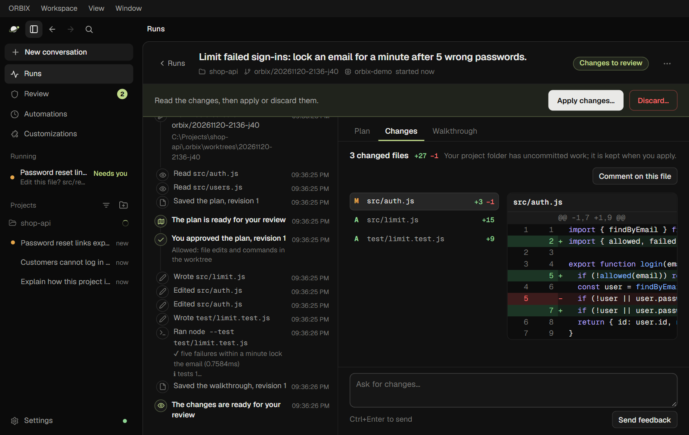
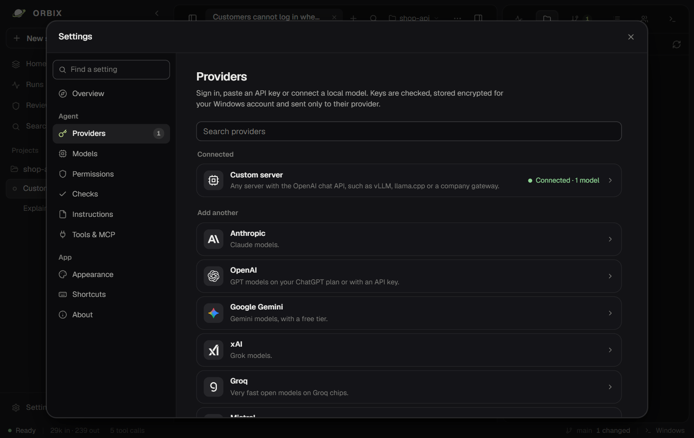
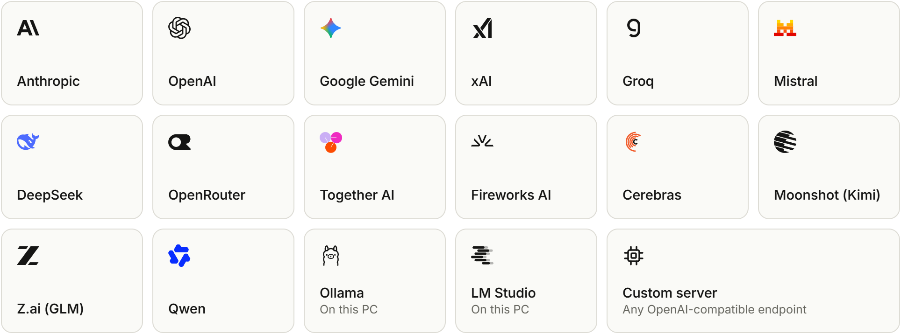
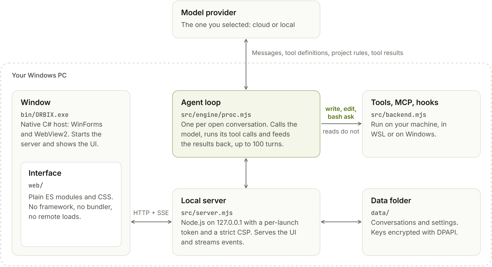
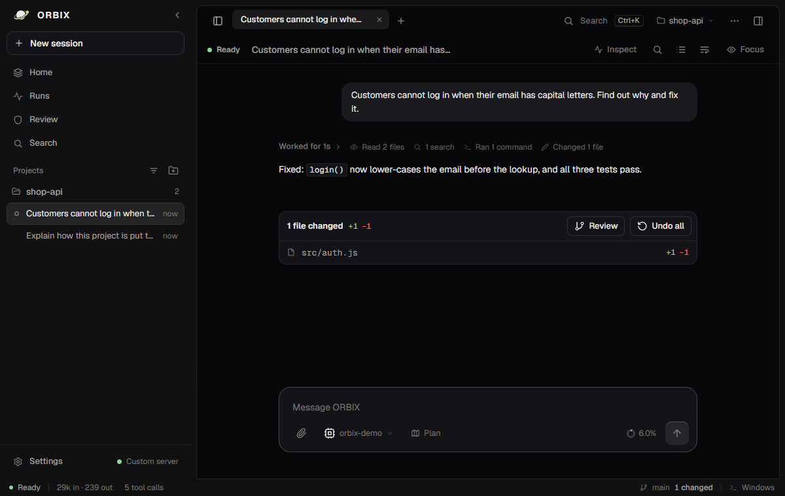
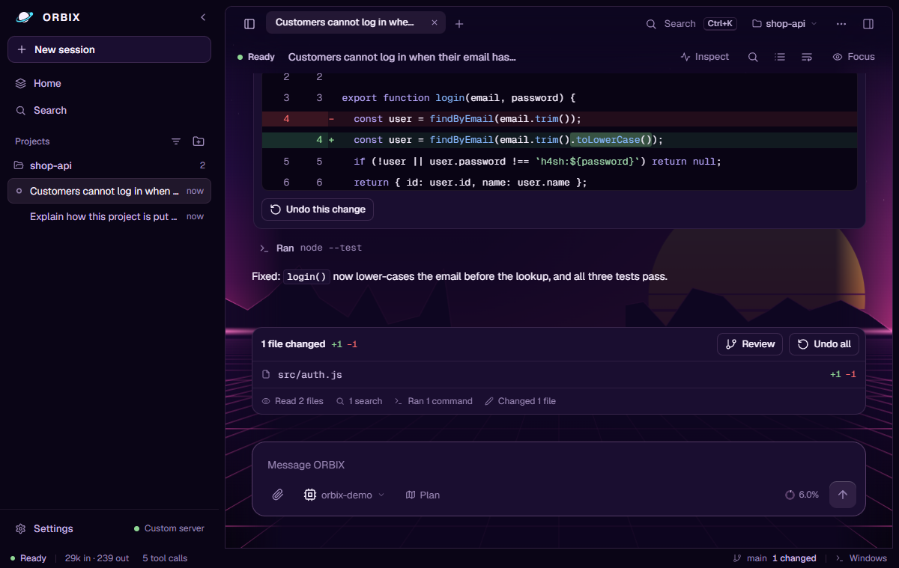

<div align="center">

<picture>
  <source media="(prefers-color-scheme: dark)" srcset="docs/img/logo-dark.svg">
  <source media="(prefers-color-scheme: light)" srcset="docs/img/logo-light.svg">
  
</picture>

**A local-first coding workspace for Windows.**<br>
It asks before it edits a file or runs a command, and every file change can be undone.<br>
Bring your own API key or run a local model.

[](https://github.com/chsxthwik/ORBIX/releases/latest)
[](https://github.com/chsxthwik/ORBIX/actions/workflows/test.yml)
[](#install)
[](LICENSE)

[Install](#install) · [Website](https://orbix-agent.vercel.app) · [Architecture](docs/ARCHITECTURE.md) · [Changelog](CHANGELOG.md) · [Security](SECURITY.md)

</div>

<br>


<sub>Screenshots use a sample project and a scripted local model; the tools in them really ran.</sub>

## Install

Download the `ORBIX-Setup` installer from the [latest release](https://github.com/chsxthwik/ORBIX/releases/latest) and run it. It installs ORBIX for your Windows account, with a Start menu and desktop shortcut, and needs no administrator rights and no Node.js. The installer is not code-signed yet, so Windows SmartScreen asks for confirmation the first time (More info, then Run anyway).

1. Press <kbd>Ctrl</kbd>+<kbd>,</kbd> and open **Providers**. Sign in with ChatGPT, xAI, OpenCode or OpenRouter, paste an API key and press **Check & save**, or connect a local model.
2. Open a project folder, describe a task and press <kbd>Enter</kbd>.

ORBIX keeps itself up to date. It checks GitHub for a new version when it opens and every few hours, downloads it in the background and installs it when you close ORBIX; **Restart** at the bottom of the sidebar installs it at once. Settings → About → Updates has Check now and a switch to turn this off. Settings and conversations are kept in `%LOCALAPPDATA%\ORBIX`, so they stay through every update.

ORBIX runs on Windows 10 and 11, using WSL or native Windows to run commands. The app and its agent run on your machine; there is no account or subscription. You pay your provider directly, or nothing with a local model.

## How a task runs

**Runs** (<kbd>Ctrl</kbd>+<kbd>2</kbd>) take one task from its description to changes you have reviewed. Pick a Git project, describe the task, and choose **Plan first** or **Straight to work**.

1. **Plan.** The agent reads the code and saves an implementation plan, changing nothing. Comment on any passage or send feedback, and it writes a new revision.
2. **Approve a scope.** The dialog shows the run's worktree, its branch and what you allow: file edits, or edits and commands. Files outside the worktree and destructive commands (recursive delete, push, publish, history rewrite) ask every time.
3. **Work in a worktree.** Every run has its own git worktree and branch, so your checkout is untouched and several runs can work at once.
4. **Review.** Each step in the timeline opens what it produced. Read the diff, the test log and the walkthrough.
5. **Apply or discard.** Apply merges into the branch the run started from and keeps your own uncommitted work; a conflict changes nothing on either side. Discard removes the worktree and branch.

**Review** (<kbd>Ctrl</kbd>+<kbd>3</kbd>) lists everything that waits for you across projects: approvals, plans, finished changes, interrupted runs. If ORBIX closes mid-run, the run says what was in flight and continues only when you say so.

For a quick question or a small change, a conversation works as before: reading runs freely, edits and commands ask first (<kbd>1</kbd> allow once, <kbd>2</kbd> for the session, <kbd>Esc</kbd> deny), and every edit can be undone. When a reply ends, its steps fold into one line ("Worked for 14s · Read 2 files · Ran 1 command") above the answer.

<table>
<tr>
<td width="50%"></td>
<td width="50%"></td>
</tr>
<tr>
<td><b>Review.</b> Every decision that waits for you, with its buttons in place.</td>
<td><b>Changes.</b> What a run changed, file by file, against where it started.</td>
</tr>
<tr>
<td></td>
<td></td>
</tr>
<tr>
<td><b>Conversations.</b> The steps fold into one line; open it to see each one.</td>
<td><b>Connect a model.</b> Keys are checked with the provider before they are saved.</td>
</tr>
</table>

## What is included

| Area | Details |
| --- | --- |
| **Agent** | Tools for `read`, `write`, `edit`, `glob`, `grep`, `bash`, `todo`, `web_fetch` and `web_search`, plus `task`, which runs read-only helper agents side by side. Plan mode only reads. `/goal` keeps working for up to 6 rounds. Older messages are summarized when the context fills up. |
| **Models** | 17 providers and any OpenAI-compatible server, including your ChatGPT plan without an API key. Live model lists, the thinking levels each model really accepts, and separate fast and plan models. Tokens and context show in the interface, and cost when the model's pricing is known. |
| **Workspace** | Session tabs, and a side panel with Run, Files, Changes (stage, unstage, discard, commit), Plan, Agents and Console, plus Review for a session on its own branch. Branch from any of your messages, attach images and files, mention files with `@`, export a conversation to HTML. |
| **Windows or WSL** | Commands, tools, MCP servers, git and hooks all run in one place: a WSL distribution, or Windows with `cmd.exe` or PowerShell. Paths are translated between the two. |
| **Project context** | Follows `AGENTS.md` or `CLAUDE.md`, and supports MCP, skills, custom slash commands and hooks. |

## Providers

<picture>
  <source media="(prefers-color-scheme: dark)" srcset="docs/img/providers-dark.png">
  <source media="(prefers-color-scheme: light)" srcset="docs/img/providers-light.png">
  
</picture>

**ChatGPT** uses the models on your ChatGPT Plus or Pro plan: sign in, no API key. It goes through the same sign-in and endpoint as the OpenAI Codex CLI, which is unofficial and can change. **xAI**, **OpenCode** and **OpenRouter** also offer a sign-in; sign-ins renew themselves.

Model lists come live from each provider and offer chat models only. Prices, context sizes and thinking support come from the [models.dev](https://models.dev) catalog, refreshed at most once a day, except where a provider reports them itself: the ChatGPT plan gives each model's context window and default thinking level, and ORBIX asks its API which levels a model accepts (a refused request, which costs nothing) and keeps the answer for a week. Thinking can be turned off only on models that allow it. The custom server slot works with vLLM, llama.cpp, a company gateway or anything else that speaks the OpenAI chat API.

## Security and privacy

Approvals are a checkpoint, not a sandbox. The agent runs with your Windows user permissions, so read what you approve.

| Action | Default |
| --- | --- |
| Reading and searching | Runs without asking |
| `write`, `edit`, `bash` | Asks first |
| MCP tools | Asks first, unless the server marks the tool read-only |
| Project MCP servers and project hooks | Do not run until you approve them |
| `web_fetch` to a local or private address | Asks first |
| Allow everything | Off. Turning it on in Settings needs a confirmation |

- **Local server:** listens only on `127.0.0.1`, behind a per-launch token held in an `HttpOnly`, `SameSite=Strict` cookie. It checks `Host` and `Origin`, and serves the UI with a strict Content Security Policy.
- **API keys:** encrypted for your Windows account with DPAPI, sent only to the provider they belong to, and never written to the log.
- **What goes to your provider:** your messages, tool definitions, project rules and tool results, including the contents of files the agent reads.
- **Other network use:** the models.dev catalog, update checks on GitHub (unless you turn them off), the ChatGPT, xAI, OpenCode and OpenRouter sign-ins if you use them, and `web_fetch` and `web_search` when the agent calls them. ORBIX has no telemetry.
- **On disk:** conversations are stored as plain text in the data folder (`%LOCALAPPDATA%\ORBIX`, or `data` in a clone) and can contain anything that appeared in a chat, so treat that folder as sensitive.

To report a vulnerability, see [SECURITY.md](SECURITY.md).

## Architecture

<picture>
  <source media="(prefers-color-scheme: dark)" srcset="docs/img/architecture-dark.png">
  <source media="(prefers-color-scheme: light)" srcset="docs/img/architecture-light.png">
  
</picture>

ORBIX is a local Node.js server and an interface written in plain ES modules, shown in an Electron window. There is no bundler or framework; the only npm package the app ships is electron-updater. [docs/ARCHITECTURE.md](docs/ARCHITECTURE.md) covers start-up, the API, the agent loop, tools and storage.

## Extending ORBIX

| Feature | Where it lives |
| --- | --- |
| **Project rules** | `AGENTS.md`, `CLAUDE.md` or `.omp/AGENTS.md` in the project. `/init` writes a first version. |
| **MCP servers** | Settings, Tools & MCP, or `.mcp.json` in the project. Stdio and HTTP. |
| **Skills** | A folder with a `SKILL.md` in `.agents/skills`, `.claude/skills` or `.omp/skills`. |
| **Slash commands** | Markdown files in `.omp/commands` or `.claude/commands`. `$ARGUMENTS` and `$1` to `$9` are filled in. |
| **Hooks** | `hooks.json` in the data folder, or `.orbix/hooks.json` in a project. Events: `PreToolUse`, `PostToolUse`, `UserPromptSubmit`, `Stop`. Exit code 2 blocks the step and tells the model why. |
| **Model roles** | Settings, Models: a fast model for titles, summaries and helper agents, and a plan model for `/plan`. |
| **Web search** | Settings, Tools & MCP: Brave Search, Tavily or your own SearXNG. The `web_search` tool appears once one is set up. |

<details>
<summary><b>Keyboard shortcuts</b></summary>
<br>

| Keys | Action |
| --- | --- |
| <kbd>Ctrl</kbd>+<kbd>K</kbd> | Search conversations, files, projects and commands |
| <kbd>Ctrl</kbd>+<kbd>N</kbd> | New session |
| <kbd>Ctrl</kbd>+<kbd>,</kbd> | Settings |
| <kbd>Ctrl</kbd>+<kbd>B</kbd> / <kbd>Ctrl</kbd>+<kbd>J</kbd> | Show or hide the sidebar / side panel |
| <kbd>Ctrl</kbd>+<kbd>L</kbd> | Focus the message box |
| <kbd>Alt</kbd>+<kbd>1</kbd> to <kbd>9</kbd> | Switch to a tab |
| <kbd>Alt</kbd>+<kbd>↑</kbd> / <kbd>Alt</kbd>+<kbd>↓</kbd> | Jump to your previous / next message |
| <kbd>Enter</kbd> / <kbd>Alt</kbd>+<kbd>Enter</kbd> | Send / queue a message while the agent works |
| <kbd>/</kbd> and <kbd>@</kbd> | Slash commands / mention a file |
| <kbd>1</kbd> <kbd>2</kbd> <kbd>Esc</kbd> | Allow once / allow for this session / deny. <kbd>Esc</kbd> also stops the agent |

</details>

<details>
<summary><b>Slash commands</b></summary>
<br>

| Command | Action |
| --- | --- |
| `/plan` | Toggle plan mode: the agent only reads and plans |
| `/undo` | Undo the file changes from the last reply |
| `/retry` | Answer the last message again |
| `/compact [focus]` | Summarize older messages to free up context |
| `/model [fast\|plan] [provider/model]` | Show or switch a model |
| `/cost` | Tokens and cost of this session |
| `/init [focus]` | Write an `AGENTS.md` with the project's rules |
| `/review [focus]` | Review uncommitted changes for bugs and risks |
| `/commit [notes]` | Write a message for the staged changes and commit |
| `/branch` | Continue the conversation in a new tab. Files are not reverted |
| `/goal <text>` | Keep working on a goal by itself, for up to 6 rounds |
| `/memory`, `/hooks`, `/mcp`, `/skills`, `/help` | Show the project memory file, hooks, MCP servers, skills and help |

</details>

## Themes

Under Settings, Appearance: System, Dark, Light, Midnight and Frost, and five scene themes with a moving picture behind the conversation (ORBIX, Synthwave, Koi pond, Aurora and Halftone dusk). A scene moves faster while the agent works and sends up fireworks when a task finishes; Animate scenes keeps it still, and so does the Windows reduce-motion setting.

<table>
<tr>
<td width="50%"></td>
<td width="50%"></td>
</tr>
<tr>
<td><b>Dark</b></td>
<td><b>Light</b></td>
</tr>
<tr>
<td></td>
<td></td>
</tr>
<tr>
<td><b>ORBIX</b> (scene)</td>
<td><b>Synthwave</b> (scene)</td>
</tr>
</table>

## Development

Node.js 22 or newer.

```bash
npm install        # Electron and the installer builder
npm start          # run the app from source (its data stays in ./data)
npm test           # about 800 tests, with no network and no API keys
npm run dist       # build the installer into dist/
```

```text
electron/  the Windows app: window, title bar, links, installer entry
src/       the local server: HTTP API, event stream, WSL and Windows backend
src/engine the agent: loop, model clients, tools, MCP, hooks, sessions
web/       the interface: plain ES modules and CSS, no build step
test/      regression tests on Node's built-in runner
e2e/       npm run e2e: a run driven through the real interface in headless Chromium
tools/     shots.mjs: the README and website screenshots, taken from a real ORBIX
```

Read [CONTRIBUTING.md](CONTRIBUTING.md) before opening a pull request.

## License

[FSL-1.1-MIT](LICENSE): free to use, read, modify and distribute for any purpose except a competing product. Each release converts to MIT two years after its date. Third-party notices are in [NOTICE.md](NOTICE.md). Provider logos are trademarks of their owners and only identify each provider.
