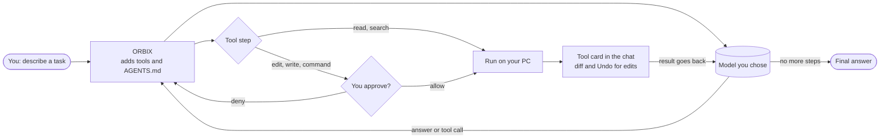

<div align="center">

<picture>
  <source media="(prefers-color-scheme: dark)" srcset="docs/img/banner.svg">
  <source media="(prefers-color-scheme: light)" srcset="docs/img/banner-light.svg">
  
</picture>

**A Windows desktop app where an AI agent works on your code.**<br>
It reads your files, edits them and runs commands. You see every step, approve every change, and can undo any of it.

[](LICENSE)
[](#requirements)
[](CHANGELOG.md)
[](#quick-start)
[](#providers)
[](#build-from-source)

[Quick start](#quick-start) &nbsp;|&nbsp; [Screenshots](#screenshots) &nbsp;|&nbsp; [How it works](#how-it-works) &nbsp;|&nbsp; [Providers](#providers) &nbsp;|&nbsp; [Safety](#safety) &nbsp;|&nbsp; [Shortcuts](#keyboard-shortcuts) &nbsp;|&nbsp; [FAQ](#faq) &nbsp;|&nbsp; [Build](#build-from-source)

</div>

<br>

<p align="center">
  
</p>

## Why ORBIX

Most coding agents live in a terminal or a browser tab. ORBIX is a small native Windows app built around one idea: you stay in control of what the agent does to your project.

- **It asks first.** Reading and searching never ask. Editing a file or running a command shows exactly what it will do and waits for you.
- **Undo is built in.** Every file change has an **Undo this change** button. `/undo` reverts the last reply.
- **Your choice of model.** 17 providers, from Anthropic and OpenAI to a local Ollama. Keys stay on your PC.
- **Nothing to install.** Unzip and run. The release zip carries its own Node.js.

## Features

<table>
<tr>
<td width="33%" valign="top">

### Its own agent
Built in, no other agent program needed. Tools: read, write, edit, bash (PowerShell on Windows), glob, grep, web fetch, task list and helper agents that research in parallel.

</td>
<td width="33%" valign="top">

### Approvals inline
The question appears above the message box with the exact file or command. Press <kbd>1</kbd> allow once, <kbd>2</kbd> allow for the session, <kbd>Esc</kbd> deny.

</td>
<td width="33%" valign="top">

### Undo everything
Per-edit **Undo this change**, **Undo all** for a reply, and `/undo`. A summary card lists every file changed with +/- counts and a **Review** button.

</td>
</tr>
<tr>
<td valign="top">

### 17 providers
Anthropic, OpenAI, Gemini, xAI, Groq, Mistral, DeepSeek, OpenRouter and more, plus local Ollama and LM Studio. Model lists, prices and context sizes come live from the provider.

</td>
<td valign="top">

### Thinking and cost
Thinking levels for models that support them. Live token, context and cost display in the status bar. Automatic retry when a provider is busy.

</td>
<td valign="top">

### Project aware
Follows `AGENTS.md` / `CLAUDE.md`. Supports MCP servers, skills (`SKILL.md`), custom slash commands and `@file` mentions.

</td>
</tr>
<tr>
<td valign="top">

### A real workspace
Tabs for several sessions, file browser and viewer, git changes with diffs (stage, unstage, discard, commit), a console and a plan panel.

</td>
<td valign="top">

### Windows or WSL
Run commands on Windows or inside WSL (Settings, Behavior). Projects can live on either side.

</td>
<td valign="top">

### Light and dark
Command palette (<kbd>Ctrl</kbd>+<kbd>K</kbd>), light and dark themes, and a notification when the agent finishes while the window is in the background.

</td>
</tr>
</table>

## Screenshots

<table>
<tr>
<td width="50%"><br><sub><b>Home.</b> Pick a project, describe a task, press Enter.</sub></td>
<td width="50%"><br><sub><b>Result.</b> Diff, <i>Undo this change</i>, and a summary of changed files.</sub></td>
</tr>
<tr>
<td><br><sub><b>Answers.</b> Markdown, tables, highlighted code and diffs.</sub></td>
<td><br><sub><b>Providers.</b> Paste a key, or connect a local model.</sub></td>
</tr>
<tr>
<td><br><sub><b>Command palette</b> (Ctrl+K).</sub></td>
<td><br><sub><b>Light theme.</b></sub></td>
</tr>
</table>

<sub>Screenshots use a demo project and a local demo model server, not a real account.</sub>

## How it works



1. **You write a task** ("fix the login bug").
2. **ORBIX sends it to the model you picked**, together with the agent's tools and your project rules (`AGENTS.md`).
3. **The model answers with steps**: read a file, search, edit, run a command. ORBIX runs each step on your PC and shows it as a card.
4. **The result goes back to the model**, which decides the next step, until the task is done.
5. **Everything is saved** in the `data` folder: conversations, settings and your keys (encrypted).

<details>
<summary><b>Architecture</b></summary>
<br>

<br>

The window (`bin\ORBIX.exe`) is a small native Windows program. It starts a local Node.js server (`src/`) that only this window can talk to, and shows the interface (`web/`). The server runs the agent, which calls the model provider you chose and the tools on your PC.
</details>

## Quick start

1. **Unzip** anywhere and double-click `bin\ORBIX.exe` (or `ORBIX.vbs`). Run `Create-Shortcuts.cmd` once for Desktop and Start-menu shortcuts.
2. Press <kbd>Ctrl</kbd>+<kbd>,</kbd>, open **AI providers**, paste an API key and press **Check & save**. You can also sign in with OpenRouter or connect a local model.
3. **Pick a project folder** on the home screen, describe a task and press <kbd>Enter</kbd>.

When the agent wants to edit a file or run a command, it asks: **Allow once**, **Allow for this session**, or **Deny**. Not sure it is set up right? Press <kbd>Ctrl</kbd>+<kbd>K</kbd> and choose **Diagnostics**.

### Requirements

Windows 10 or 11 (x64) with the WebView2 Runtime (included in Windows 11 and recent Windows 10), and an API key or a local model server. Nothing else: the release zip includes Node.js.

## Providers

<table>
<tr>
<td>Anthropic</td><td>OpenAI</td><td>Google Gemini</td><td>xAI</td><td>Groq</td><td>Mistral</td>
</tr>
<tr>
<td>DeepSeek</td><td>OpenRouter<br><sub>key or sign-in</sub></td><td>Together AI</td><td>Fireworks AI</td><td>Cerebras</td><td>Moonshot (Kimi)</td>
</tr>
<tr>
<td>Z.ai (GLM)</td><td>Qwen</td><td>Ollama<br><sub>local</sub></td><td>LM Studio<br><sub>local</sub></td><td colspan="2">Custom server<br><sub>any OpenAI-style API: vLLM, llama.cpp, a company gateway</sub></td>
</tr>
</table>

Model lists come live from each provider, so they are always current but need the provider to be reachable.

## Keyboard shortcuts

| Keys | What it does |
| --- | --- |
| <kbd>Ctrl</kbd>+<kbd>K</kbd> | Command palette (commands and saved conversations) |
| <kbd>Ctrl</kbd>+<kbd>N</kbd> | New session |
| <kbd>Ctrl</kbd>+<kbd>,</kbd> | Settings |
| <kbd>Ctrl</kbd>+<kbd>B</kbd> | Show or hide the sidebar |
| <kbd>Ctrl</kbd>+<kbd>J</kbd> | Show or hide the side panel |
| <kbd>Ctrl</kbd>+<kbd>L</kbd> | Focus the message box |
| <kbd>Alt</kbd>+<kbd>1</kbd>...<kbd>9</kbd> | Switch to tab 1 to 9 |
| <kbd>Enter</kbd> / <kbd>Alt</kbd>+<kbd>Enter</kbd> | Send / queue a message while the agent works |
| <kbd>/</kbd> and <kbd>@</kbd> | Slash commands / mention a file |
| <kbd>1</kbd> <kbd>2</kbd> <kbd>Esc</kbd> | Approval: allow once / allow for session / deny (Esc also stops the agent) |

## Safety

- **Reading and searching never ask. Writing, editing and commands ask first.** You can switch to "Allow everything" in Settings, Behavior.
- **Undo for every file change**, per edit or for a whole reply.
- **Keys** are checked with the provider, then stored encrypted for your Windows account (DPAPI). They are never shown again and only go to the provider you chose.
- **Local only.** The server listens on `127.0.0.1` and needs a per-launch token. A strict Content-Security-Policy is served with the UI.
- **Project MCP servers** (`.mcp.json`) only start after you allow them, and the prompt shows the full command.
- **Web fetch** refuses local and private network addresses unless you approve.
- Everything the app saves stays in its own `data` folder.

Details and how to report a vulnerability: [SECURITY.md](SECURITY.md). The agent runs with your Windows user's permissions, so review what you approve.

## Slash commands

| Command | What it does |
| --- | --- |
| `/plan` | Plan mode: the agent only reads and plans, it changes nothing |
| `/undo` | Undo the file changes from the last reply |
| `/retry` | Answer the last message again |
| `/compact [focus]` | Summarize older messages to free up context (also automatic near the limit) |
| `/model [provider/model]` | Show or switch the model |
| `/cost` | Tokens and cost of this session |
| `/init` | Write an `AGENTS.md` with the project's rules |
| `/review` | Review the uncommitted changes for bugs and risks |
| `/commit` | Write a message for the staged changes and commit (asks first) |
| `/branch` | Start a new session from the conversation up to a message of yours |
| `/goal <text>` | Keep working on a goal for up to 6 rounds. Esc or `/goal stop` ends it |
| `/memory`, `/hooks` | Show where `AGENTS.md` lives, and list the hooks that run |
| `/mcp`, `/skills`, `/help` | List MCP servers, skills, and what the agent can do |

## Project rules, MCP and skills

| Feature | Where to put it |
| --- | --- |
| **Project rules** | `AGENTS.md` or `CLAUDE.md` at the project root (also `.omp/AGENTS.md`). The agent follows them in every session. `/init` writes a first version. |
| **MCP servers** | Settings, Tools & MCP, or a `.mcp.json` in the project. Project servers ask before they start. |
| **Skills** | A folder with a `SKILL.md` in `.agents/skills`, `.claude/skills` or `.omp/skills`. The agent reads one when it fits the task. |
| **Custom slash commands** | Markdown files in `.omp/commands` or `.claude/commands`. |
| **Hooks** | `hooks.json` in the app's data folder, or `.orbix/hooks.json` in a project (asks once). Events: `PreToolUse`, `PostToolUse`, `UserPromptSubmit`, `Stop`. Exit code 2 blocks the step and tells the model why. |
| **Model roles** | Settings, AI providers, Models: a fast model for titles, summaries and helper agents, and a plan model for `/plan`. |
| **Web search** | Settings, Tools & MCP: connect Brave Search, Tavily or your own SearXNG. The agent gets a `web_search` tool once one is set up. |
| **Branching** | Every message of yours has a Branch button that opens a new session from that point. |

## Optional: the OMP CLI

If the [OMP](https://omp.sh) command-line agent is installed (in WSL or on Windows), ORBIX detects it and lets you run a session with it instead, with its own sign-ins and settings. You do not need it; without it the app never asks about it.

## FAQ

<details>
<summary><b>Does ORBIX need an account or a subscription?</b></summary>
<br>
No ORBIX account. You bring your own API key (or a local model). You pay your provider directly, and the status bar shows tokens and cost when the model's price is known.
</details>

<details>
<summary><b>Where is my data?</b></summary>
<br>
In the <code>data</code> folder next to the app: conversations, settings and encrypted keys. Conversations can contain secrets that appeared in your chats, so treat that folder as sensitive. Your project files are only touched when you approve an edit.
</details>

<details>
<summary><b>What gets sent to the provider?</b></summary>
<br>
Your messages, the agent's tool definitions, your project rules, and the results of the tool steps (for example the text of a file the agent read). It goes only to the provider you selected.
</details>

<details>
<summary><b>Can I run it fully offline?</b></summary>
<br>
Yes, with a local model server such as Ollama or LM Studio. Model lists and web fetch need a network; a local server does not.
</details>

<details>
<summary><b>Do I need the OMP CLI or Node.js?</b></summary>
<br>
No to both. The ORBIX agent is built in and the release zip bundles Node.js. Building from source needs Node.js 20 or newer.
</details>

## Build from source

```
npm run build      # bin\ORBIX.exe (uses the C# compiler built into Windows)
npm run package    # release\ORBIX-<version>-win-x64.zip
npm run icon       # assets\icon.png and assets\icon.ico
npm run doctor     # the Diagnostics checks, in the console
npm test           # regression tests (no network, no keys)
npm start          # run from source (Node.js 20 or newer)
```

The project is intentionally small: no npm dependencies, no bundler, no framework. See [CONTRIBUTING.md](CONTRIBUTING.md) for the layout and ground rules, and [CHANGELOG.md](CHANGELOG.md) for what changed.

## License

[FSL-1.1-MIT](LICENSE): free to use, read, change and share for any purpose except selling a competing product, and each version becomes MIT two years after its release. Third-party notices are in [NOTICE.md](NOTICE.md).

<div align="center">
<br>

<br>
<sub><b>ORBIX - Unified ADE</b> &nbsp;|&nbsp; a native Windows app with an agent that asks first.</sub>
</div>
